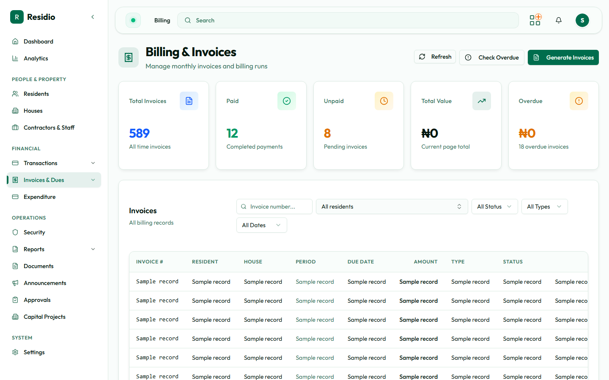

# Invoices and dues

Open **Invoices & Dues** to review the estate's billing position and work with invoice records.

## Review the queue

Filter by status (**Unpaid**, **Paid**, **Partial**, **Void**), invoice type (service charge, levy, adjustment, other), billing period (this month, last month, the last 3 months, this year, or a **Custom range** of dates), and resident, or search by invoice number. Combine filters to narrow the working set.

The cards above the list count the whole estate, not just the page on screen. **Total Invoices**, **Paid**, **Unpaid** and **Total Value** follow the filters you have set; **Overdue** always covers every overdue invoice. Select **Overdue** to filter the list to unpaid invoices. On a phone, each invoice is shown as a card with its amount, status, resident, house, period and due date.

## Generate invoices

1. Select **Generate Invoices**. The button is shown only to roles that can create invoices.
2. Choose the target month and scope.
3. Review the preview counts, warnings, eligible houses, residents, and existing invoices. A period earlier than every rate version on a house's billing profile is priced by the earliest version, and the preview warns about each one; add a rate version for that month first if a different rate applied (see [Billing and notifications settings](../settings/billing-and-notifications.md)).
4. Confirm the options for wallet allocation, resident emails, and late fees.
5. For a backfill, enter the displayed security code exactly.
6. Prepare the durable run and monitor its progress.

:::warning[Preview before prepare]
The preview is the control point. Do not prepare a run until the candidate count and warnings match the intended period and scope.
:::

## Handle an exception

Open the invoice detail page to inspect the resident, house, billing period, payments, wallet allocation, and audit history. Do not manually create a replacement invoice until you have confirmed the business key and current run status.
