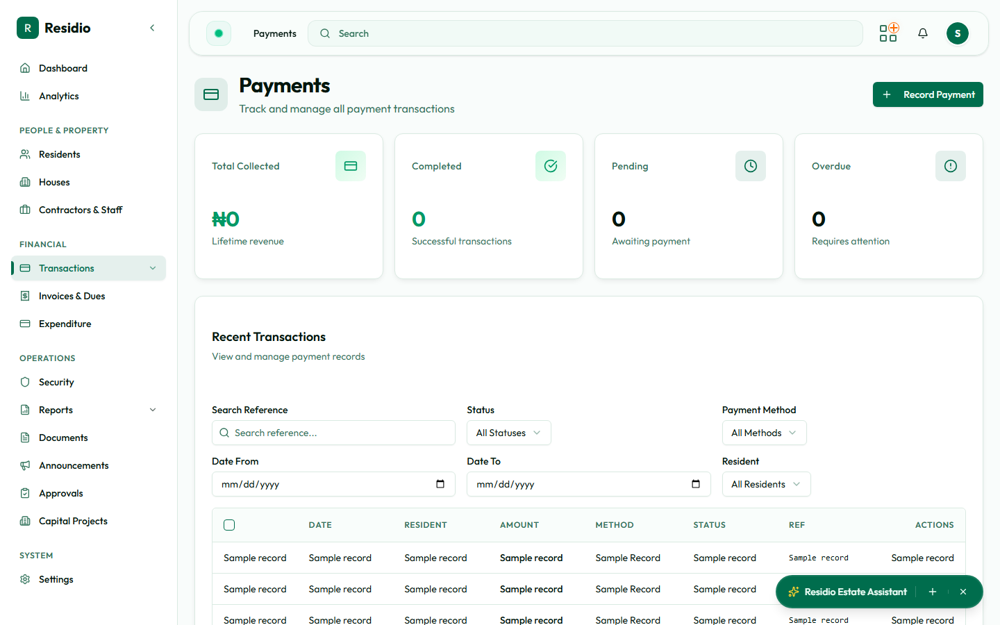

# Payments and statement imports

Use **Transactions** for individual payment records and **Import Statement** for bank statement workflows.

## Record a payment manually

1. Select **Record Payment**.
2. Identify the resident or house before entering the amount.
3. Enter the payment date, reference, account, and source details.
4. Review the allocation preview.
5. Save the payment and confirm the success notification.

## Import a statement

An uploaded statement never posts payments on its own. It is submitted, approved by a user with approval rights, and only then processed.

1. Open **Transactions → Import Statement**.
2. Upload the approved statement file.
3. Review parsed rows and duplicate warnings.
4. Correct categorization or matching issues in the preview.
5. Check that the total and row count match the source statement, then choose **Submit for approval**. This needs the `imports.review` permission and opens the import's page. An import with no matched rows cannot be submitted: the button is disabled on the import's page and the server refuses it with "No matched rows to process, so there is nothing to submit."
6. An approver opens the import (from the **Import History** page, using the **Needs approval** filter, or from the "Bank Import Awaiting Approval" notification) and chooses **Approve**, or **Reject** with a required reason. Approve needs `imports.approve`; Reject needs `imports.reject`. The person who submitted an import cannot approve it: a different approver is required, and the page shows "You submitted this import, so a different approver is required" if they try. The submitter can still reject their own submission to withdraw it.
7. Only an approved import can be processed. Once approved, anyone with `imports.review` (including the submitter) opens the import, picks the processing options (mode, skip duplicates, skip unmatched) and chooses **Process payments**. Payments are created and wallets credited only at this step.

A failed import can be reset by a super admin (the `imports.reset` permission). On the failed import's page, choose **Reset for review**. The confirmation states how many rows were already created; those rows keep their payments and are not processed again. Rows that errored in the failed run return to unmatched, so re-match them before resubmitting. The reset is audited and sends the import back to review, clearing its submitter and approver, so it must be submitted and approved again by two different people before it can be processed. It is a manual reset, not an automatic retry.

A rejected import keeps its reason on the import page and creates no payments. Approvers and reviewers can open the import pages without `imports.create`.

On the **Import History** page, click anywhere on a row to open that import. To remove an import that was never submitted or was turned down, choose **Delete** from the row menu or on the import page. Delete is offered only for imports that are pending, failed or rejected, needs `imports.create`, and asks for confirmation first. This also clears a pending import that never finished uploading.

## Verify pending payments

Open **Approvals** for transactions awaiting maker-checker verification. The reviewer should compare the submitted evidence with the transaction before approving or rejecting it.

## Related

- [Gmail import and bank feeds](../integrations/bank-feeds-and-email-import) for the automated mailbox connection and supported statement formats.
- [Payment gateway](../integrations/payment-gateway) for online card payments and their reconciliation.
