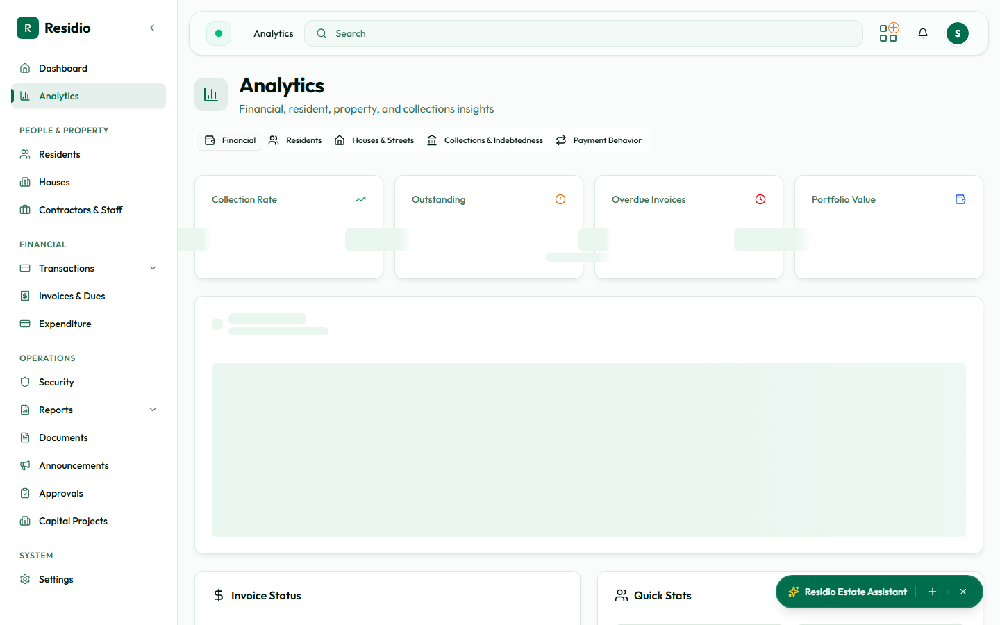

# Reports and analytics

Use **Analytics** for trends and **Reports** for generated operational or financial outputs.

## Analytics workflow

**Analytics** opens the **Financial Overview**: collection rate, outstanding balance, overdue invoices and portfolio value at the top, a revenue against expenses trend for the last 12 months, **Invoice Aging** (how many overdue invoices are overdue by each number of days), **Invoice Status** (paid, unpaid, partially paid, overdue and void), and **Quick Stats** for houses, occupancy and residents. The page has no period filter.

1. Read the summary cards first.
2. Use the trend and aging charts to locate the problem.
3. Open the source module, such as **Billing** or **Transactions**, for record-level action.

If the aging figures cannot be loaded, the card says *Invoice aging unavailable* rather than showing no overdue invoices, so an empty card is never mistaken for a clean ledger.

## Report workflow

**Reports** needs the view financial reports permission; without it you are returned to the dashboard. The page has five tabs: **New Report**, **History**, **Schedules**, **Archive** and **Wallet Check**.

1. Open **Reports → New Report**.
2. Select the report type and period.
3. Review the preview or parameters.
4. Generate and download the report only after confirming the scope.

Scheduled reports are set up on the **Schedules** tab; creating or changing a schedule needs the manage report schedules permission. They are generated and delivered by a scheduled job, without anyone signed in.

Reports are snapshots. If a number looks wrong, trace it back to residents, invoices, payments, or expenditure instead of editing the report output.
