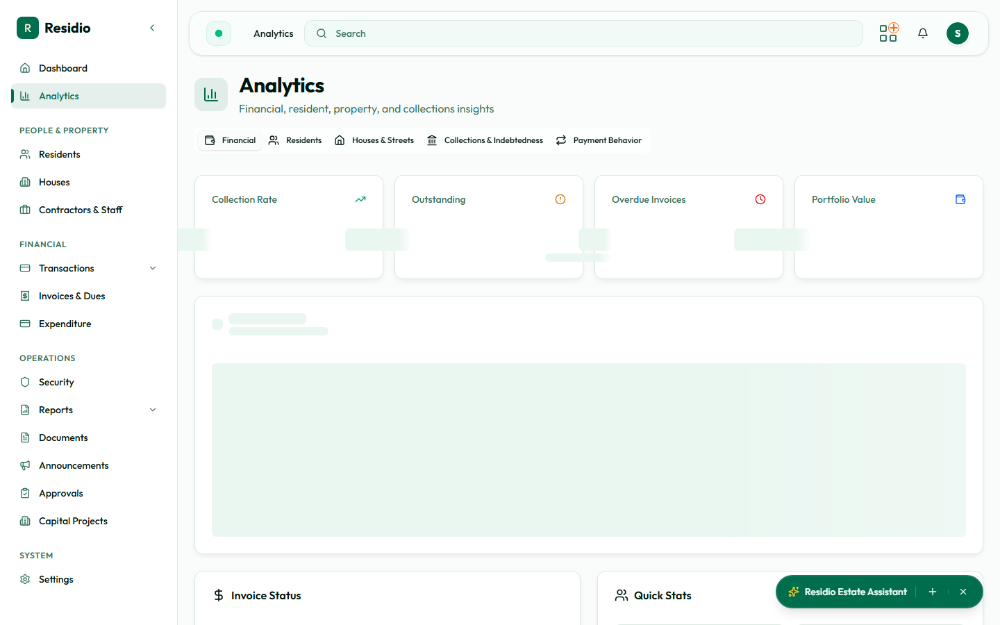

# Reports and analytics

Analytics live under **Oversight** in the sidebar. Its left menu has four groups: **Dashboard** (Oversight overview, Collections dashboard, Announcement engagement), **Reports** (Income & expenses), **Messages** and **System**. The left menu scrolls when it is taller than the screen. Use **Collections dashboard** for trends, **Income & expenses** for the income and expense breakdown, and **Announcement engagement** for announcement reach. Generated operational and financial reports have their own **Reports** entry in the main sidebar, directly under **Dashboard**, with the links **New report**, **History** and **Schedules**.

## Collections dashboard workflow

**Oversight → Collections dashboard** shows: collection rate, outstanding balance, overdue invoices and portfolio value at the top, a revenue against expenses trend for the last 12 months, **Houses by debt status and street**, **Invoice Aging** (how many overdue invoices are overdue by each number of days), **Invoice Status** (paid, unpaid, partially paid, overdue and void), and **Quick Stats** for houses, occupancy and residents. The page has no period filter. Tabs at the top show one part at a time: **Summary** (one card for each part, with its key number), **Totals**, **Trends**, **Debt status**, **Invoice aging** and **Invoices & houses**. The open tab is part of the page address (`?section=debt-status`), so a link can open one tab.

**Houses by debt status and street** is a stacked bar chart with one bar for each street. Each bar shows how many houses are in **Arrears**, **Outstanding**, **Paid in Full** and **Credit**. The subtitle gives the estate totals, and the title gives the "as at" date. It counts the same houses and uses the same rule as the debt status report: active, verified, lived-in houses that have an active primary resident. The labels come from **Settings > Debt Status**. The chart refreshes every minute, and when you return to the browser tab. Only users who can view financial reports see this section.

1. Read the summary cards first.
2. Use the trend and aging charts to locate the problem.
3. Open the source module, such as **Billing** or **Transactions**, for record-level action.

If the aging figures cannot be loaded, the card says *Invoice aging unavailable* rather than showing no overdue invoices, so an empty card is never mistaken for a clean ledger.

## Income and expenses

**Oversight → Income & expenses** shows the financial summary and the transaction breakdown by category, from imported bank statements. It needs the view financial reports permission.

## Report workflow

Each report type has its own view permission. Today every report type needs the view financial reports permission. **Reports** in the main sidebar opens when you have the permission of at least one report type; without one, you are returned to the dashboard. The page has five tabs: **New Report**, **History**, **Schedules**, **Archive** and **Wallet Check**. Step 1 of **New Report**, **History**, **Archive** and **Schedules** show only the report types you have the permission for.

1. Open **Reports → New report** in the sidebar.
2. On step 1, select the report type. The list on the left has a search field and groups (**Money in and out**, **Debts**, **Levies**); select a group name to close or open it. The right side shows what the report asks for (a date range or "as of today", and bank accounts or none), the next step, and an **Example layout** of the report. Then select the period, if the report asks for one.
3. Review the preview or parameters.
4. Generate and download the report only after confirming the scope. If the report cannot be generated, a message tells you why.

Scheduled reports are set up on the **Schedules** tab; creating or changing a schedule needs the manage report schedules permission. Without it, the tab shows the schedules and a line that tells you this. You cannot schedule a report that cannot be generated yet: on the last step of **New Report**, the schedule switch is not shown for it, and a line tells you why. They are generated and delivered by a scheduled job, without anyone signed in. Each scheduled email carries the report as a PDF attachment, with a short message naming the report and the period it covers. Report PDFs, the on-screen report and these emails all show the estate name from **Settings > Estate**.

## Debtors and aging

**Debtors and aging** is in the **Debts** group. It replaces the **Debtors Report** and the **Invoice Aging Report**. The report is always as of today, so it has no time period step and no bank account step.

The report shows four figures at the top: **Total owed**, **Debtors**, **Owed over 90 days** and **Oldest debt**. A bar chart shows the amount owed in each age bucket: **Current** (not yet due), **1-30 days**, **31-60 days**, **61-90 days** and **Over 90 days**. The age is the number of days after the due date. The table has one row for each debtor, with the house, the street, the phone numbers and the email address. It shows the amount for each bucket and the total. The last row gives the totals. An unpaid invoice that has no resident is shown on a row called **No resident linked**, one row for each house. Its money is in the totals, but it is not counted in **Debtors**.

On the **Options** step, the switch **Show invoice lines** adds one row for each unpaid invoice under its debtor. The switch is off unless you turn it on.

Reports that were made before this change stay in **History** and **Archive**, and you can open them. You cannot make a new **Debtors Report** or **Invoice Aging Report**. A schedule that was set up for one of them now runs **Debtors and aging**.

## Project spend

**Project spend** is in the **Money in and out** group. It shows the spend on each capital project in the period you choose and up to the end of that period. It needs the permission to view financial reports.

The report shows four figures at the top: **Projects**, **Spend in period**, **Spend to date** and **Budget left**. **Budget left** is the budget less the spend to date, for the projects that have a budget. A bar chart shows the spend in the period for each project. The table has one row for each project, with the columns **Project**, **Status**, **Budget**, **Spend in period**, **Spend to date**, **Budget left**, **Milestones** (for example "1 of 3 done") and **Next milestone** (the first milestone that is not complete, with its due date). The last row gives the totals.

The spend is the amount of the expenses that are linked to the project. A bank statement row that you matched to a project is counted after the import turns it into an expense. It is not counted twice. Only expenses with the status paid are counted, the same as in **Financial Overview**.

## Petty cash

**Petty cash** is in the **Money in and out** group. It shows each petty cash account for the period you choose. It needs the permission to view financial reports.

The report shows four figures at the top: **Accounts**, **Top-ups**, **Spend** and **Closing balance**. A bar chart shows the spend for each account. The table has one row for each account, with the columns **Account**, **Opening balance**, **Top-ups**, **Spend** and **Closing balance**. The opening balance is the starting float plus the top-ups before the period, less the spend before the period. The top-ups are the bank statement rows and the email transactions that you matched to the account and that were imported. If the same transfer was imported both ways, it is counted two times. The last row gives the totals.

On the **Options** step, the switch **Show spend lines** adds one row for each expense under its account. It is off until you turn it on. A schedule of this report always runs with spend lines off, because the schedule form has no switch for them. If the balance now on record for an account is different from the closing balance, a note under the table names the account. This can happen when cash collections or top-ups made by hand changed the balance, because these keep no history.

## Dues, levies and collection status

**Dues, levies and collection status** is in the **Debts** group. It replaces the **Indebtedness Report** and the **Indebtedness Detail Report**. It shows one sheet for the estate, with one row for each house. This report asks for a time period, which sets the months of the grid, but not for bank accounts. The report is as of one day: its title reads "Dues, levies and collection status - Security Dues - As of 02 November 2026", and no period is printed.

On step 1, the card of this report shows the **Charge** buttons: **Security Dues** (the default), **Development Levy** and **Transformer Fee**. The list comes from the charge categories of the estate. The report counts only the invoices of the charge you choose, for the months, for **Owed** and for the invoice lines. The debt status and the wallet credit use the same charge. A line under the buttons says who the **Primary Resident** is. For **Security Dues**, it is the tenant, else the owner-occupier (if the billing profile of the house says the landlord pays, it is the landlord). For **Development Levy** and **Transformer Fee**, it is the landlord: the owner-occupier, else the landlord, else the developer. A schedule keeps the charge you chose.

The report shows four figures at the top: **Houses fully paid**, **Houses part paid**, **Houses not paid** and **Total owed**. A house is fully paid when it owes nothing. A house is part paid when it owes money and has paid at least one month in the period. A house is not paid when it owes money and has paid no month in the period. A bar chart shows the amount owed on each street.

The table has these columns for each house: **House**, **Street**, **Primary Resident**, **Months paid** (for example "3 of 4", the months in the period that are paid, out of the months that have an invoice), **Months owed**, **Levy**, **Owed** and **Status**. **Levy** shows **Paid**, **Part paid**, **Not paid** or **No levy** for the development levy. **Owed** is all the money that is still unpaid on the house for the chosen charge, with earlier months. It is the same amount as the **Indebtedness Report** gave. **Status** is the debt status from **Settings > Debt Status**. The last row gives the totals. A house that has paid more than it owes shows 0.00 and is not subtracted from the total.

The report shows at most 24 months, the latest ones. Void invoices are not counted. Invoices of other charges are not counted. A development levy that is billed under Security Dues shows only in **Levy**, not in the months.

On the **Options** step, the switch **Show invoice lines** adds one row for each unpaid invoice under its house. It is off until you turn it on. The switch **Unoccupied Properties** adds the houses that have no active resident.

When you open the report, you can switch between **Sheet** and **Grid of months**. The grid has one row for each house and one column for each month. Each cell shows **Paid up**, **Outstanding**, **Overdue** or **No invoice**, with the same colours as the estate map. The two columns at the end show the levy and the amount owed. The grid is for the screen only. **Export PDF**, **Export CSV** and the scheduled email carry the sheet.

Reports that were made before this change stay in **History** and **Archive**, and you can open them. You cannot make a new **Indebtedness Report** or **Indebtedness Detail Report**. A schedule that was set up for one of them now runs **Dues, levies and collection status** for **Security Dues**.

## Collection rate by street

**Collection rate by street** is in the **Debts** group. It asks for a time period, but not for bank accounts. It counts the invoices that fall due in the period, for all charges. Void invoices are not counted.

The report shows four figures at the top: **Billed**, **Collected**, **Owed** and **Collection rate**. **Billed** is the amount on the invoices. **Collected** is the amount paid against them. **Owed** is the rest. **Collection rate** is **Collected** divided by **Billed**. A bar chart shows the collection rate of each street. The table has one row for each street, with the number of houses, the three amounts and the rate. The last row gives the totals. A street with no invoices in the period shows a dash for the rate and is not in the chart.

The streets and houses are the same as on **Houses by debt status and street** and in the debt status report: active, verified, lived-in houses that have an active primary resident.

## Expenses by category and vendor

**Expenses by category and vendor** is in the **Money in and out** group. It asks for a time period, but not for bank accounts. It counts the paid expenses with a date in the period. Pending and cancelled expenses are not counted.

The report shows four figures at the top: **Total spent**, **Expenses** (the number of expenses), **Categories used** and **Largest category**. A bar chart shows the eight largest categories. The table has one row for each category and one row for each vendor, with the number of expenses, the total and the share of the total spent. The category rows add up to the total, and so do the vendor rows. An expense with no vendor is counted under **Resident (no vendor)**, **Staff (no vendor)** or **No vendor**. An expense with no category is counted under **Uncategorised**.

On the **Options** step, the switch **Show expense lines** adds one row for each expense under its category. It is off until you turn it on. A schedule keeps the choice.

## Wallet balances

**Wallet balances** is in the **Money in and out** group. It asks for a time period, but not for bank accounts. It shows one row for each resident, with **Opening balance**, **Credits**, **Debits** and **Closing balance**. A resident has one wallet for each charge. The report adds all the wallets of a resident into one row. A resident with no balance and no movement in the period is not shown.

The four figures at the top are **Resident credit held** (the total of the closing balances, which is the credit the estate holds for residents), **Credits in period**, **Debits in period** and **Residents with credit**. A bar chart shows the credits and the debits of each month of the period.

The closing balance comes from the wallet balance now. Movements that are dated after the end of the period are taken back out of it. For a period that ends today, the closing balance is the same as the wallet balance. The opening balance is worked back from the closing balance: **Opening balance** = **Closing balance** - **Credits** + **Debits**. Days are counted in UTC.

Reports are snapshots. If a number looks wrong, trace it back to residents, invoices, payments, or expenditure instead of editing the report output.
