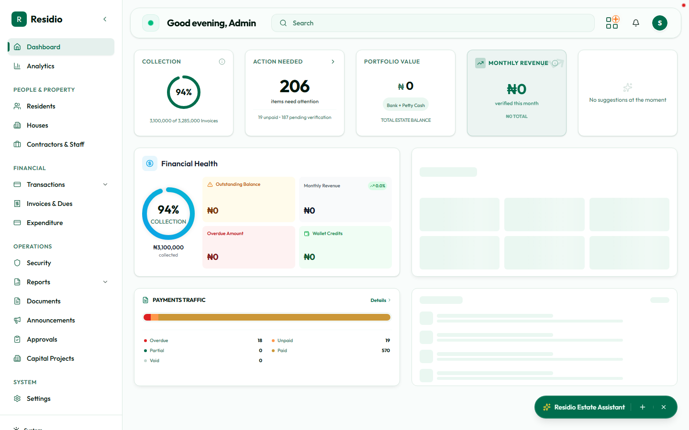
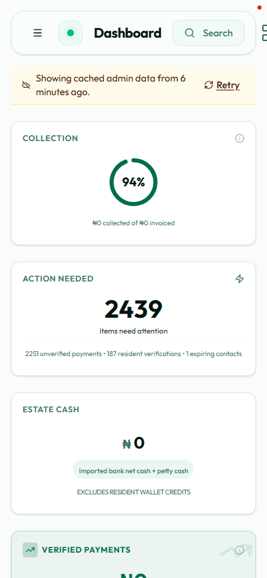

# Dashboard overview

The dashboard is your operating picture for the estate. Start here before opening a module: it shows the most urgent item, three lanes for money, people and security, an estate map, recent activity, and a Quick actions menu for the workflows you use most.

The dashboard is a triage surface: use the strip, the three lanes and the estate map to decide what needs attention, then follow the link into the source record.

On a phone, use the header menu to reach the core admin modules.

## Read the page in this order

1. **Top strip:** the band at the top greets you, shows when the figures were last updated ("As of ..."), and shows the single most urgent item, as "Most urgent: ...". It picks the first of overdue Invoices, Payments to verify, Residents awaiting review, and expiring security contacts that has a non-zero count, and links to where you resolve it. The **Quick actions** menu sits beside it.
2. **Money lane:** the headline is "Outstanding on invoices", what is still owed. Under it, one line shows "Verified this month"; hover or focus that label to read what it counts: this month's payments that a person confirmed or that came in through a bank or email statement import. Three queue rows sit under it: Payments to verify, Overdue invoice balance (with the number of overdue Invoices), and Resident wallet credits. The link beside the title is **Verify payments**.
3. **People and Houses lane:** the headline is Residents awaiting review. The queue rows show Active residents, Occupied houses, and Vacant houses. House payment counts are on the estate map's filter buttons, not here. The link beside the title is **Review residents**.
4. **Security and Access lane:** the headline is Contacts expiring soon. The status line reads "N of M contacts active", followed by a summary of anything that needs attention. The queue rows show Expired access codes, Suspended contacts, and Recent flagged entries. The link beside the title is **Open security contacts**.
5. **Estate map:** one cell for each House, grouped by street. Only the exceptions are marked: Overdue and Outstanding cells have a coloured border and their own icon. Paid up and No invoice cells are plain. The filter buttons (All, Overdue, Outstanding, Paid up, No invoice) are the legend and show the count for each status, and choosing one shows only the Houses in that state. Select a cell to open the House. The map refreshes on its own schedule, so its header shows its own time ("Map as of ..."). It is gated on the same billing view permission as the Money lane.
6. **Recent activity:** confirm recent changes are expected and traceable. It shows the latest five Payment, Resident, and security contact events; **View all** opens the audit logs. If your role cannot
   view audit logs, this card says so rather than showing an empty list. Ask an administrator
   for the "view audit logs" permission if you need it.

:::tip[Daily habit]
Use the dashboard as a queue, not a report. Resolve the highest-risk exception first, then refresh before starting the next task.
:::

## Lane links and Quick actions

Each lane has one link beside its title that opens the queue it summarises. The colour of the lane's icon shows whether it needs attention. The **Quick actions** menu in the top strip holds the shortcuts for common jobs: recording a Payment, generating Invoices, importing a statement, adding a Resident, adding a House, and adding a security contact. These open the same workflows as the sidebar. A link or menu item is hidden when your role lacks the permission for it, and the menu is hidden when your role has none of them.

## What the numbers mean

- **Unpaid:** an invoice has no settled payment.
- **Partial:** a payment exists but the invoice is not fully settled.
- **Overdue:** the invoice has passed its due date without full settlement.
- **Pending verification:** a submitted payment still needs maker-checker review.
- **Wallet credits:** resident funds available for invoice allocation.

Numbers are permission-filtered. A user with a narrower role may see fewer cards or a different set of navigation links.
