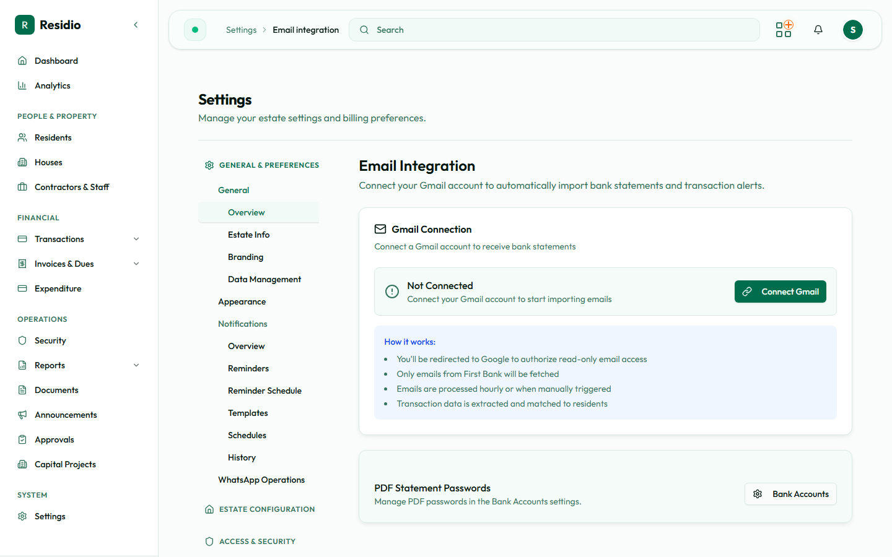

# Gmail import and bank feeds

Residio gets bank data into the system through two routes: an automated Gmail connection that reads bank alerts and statement attachments, and manual file upload from **Transactions → Import Statement**. The scheduled sync and a fetch an admin starts by hand can both post a high-confidence credit at or below the auto-process limit (₦60,000 by default) automatically. All other Gmail items land in the email review queue (see [The review queue](#the-review-queue)). An uploaded statement is submitted for approval and processed from its own import page under **Transactions → Import History**.

For the day-to-day payment workflow, see [Payments and statement imports](../finance/payments-and-imports). This page covers the connection itself.

## Connect a Gmail mailbox

Open **Settings → Connections → Gmail Import**.

1. Select **Connect** and complete the Google consent screen.
2. Grant access with the mailbox that actually receives the bank alerts, not a personal account.
   Finish the connection in the same browser and signed-in session that started it, within 10 minutes. If you are signed in as a different admin, the link is reused, or it has expired, Residio refuses it and asks you to select **Connect** again.
3. Confirm the page returns showing a connected status and a mailbox address.
4. Check the **Import rules** section so Residio reads only the relevant mail (see [Import rules](#import-rules)).
5. Wait for the first sync, then confirm imports appear.

The page shows the connection status and the last sync time. A connection that reports connected but has never synced is a criteria problem, not an authorisation problem.

:::warning[Use an estate mailbox]
Connecting a personal Gmail account ties the estate's bank feed to one person's credentials. When they leave or change their password, the feed stops. Use a mailbox the estate controls.
:::

### Import rules

The **Import rules** section shows while Gmail is connected. It holds two lists, one value per line:

- **Senders**: the email addresses or domains that Residio reads mail from, for example `firstbanknigeria.com`. If another mailbox forwards the bank mail, add that mailbox too. A forward made by a Gmail filter usually keeps the bank as the sender; a forward made by hand shows the forwarding mailbox.
- **Subject words**: Residio reads only mail that contains one of these words. Leave the list empty to read all mail from the senders.

Each sender must be an email address or a domain, with no spaces; subject words cannot contain quotes. Each list holds at most 20 values. Anyone who can open the page can see the rules; changing them needs the configure email imports permission. Every change is recorded in the audit log with the old and new lists.

### Disconnect

**Disconnect** asks for confirmation, then revokes Residio's access and stops future syncs; reconnecting needs a fresh Google sign-in. Imports already created stay in the system. Disconnect before handing over a mailbox, and reconnect with the replacement account rather than sharing credentials.

Anyone who can view email imports can open the page. **Connect Gmail** and **Disconnect** need the configure email imports permission, and **Manual Fetch** needs the trigger email imports permission; without them the buttons are hidden.

## What gets imported

The importer recognises FirstBank Nigeria transaction alerts and FirstBank statement PDFs. Statement files uploaded manually are parsed from CSV, Excel, and PDF.

Column names vary between statement types, so the parser accepts common variations of each field — transaction date, narration, credit, debit, reference, and balance. If a statement fails to parse, the most likely cause is an unrecognised export format from the bank, not a corrupted file.

## Password-protected statements

Bank statement PDFs are often password protected. Residio stores a password per bank account so both an admin-started fetch and the scheduled sync can open them without manual intervention. Each time the scheduled sync reads a stored password it records the read in the system action log; the password itself is never logged. Manage them in the **PDF Statement Passwords** row of the **Bank accounts** section on **Settings → Money → Banking**; changing them needs the manage statement passwords permission, and removing one asks first.

Passwords are stored encrypted and are never displayed back. To change one, set a new value; to stop automated opening, remove it.

## The review queue

Imported rows are matched against residents, houses, and outstanding invoices. A credit is posted automatically only when it matched a resident with high confidence (by alias or phone number) and is at or below the auto-process limit. Every other credit is queued for review.

The scheduled sync applies two more checks before it posts a credit:

- The credit must come from a bank alert. Rows from a statement attachment are always queued, because the same credit can also arrive as an alert.
- The alert must pass the **sender check**. Anyone who knows the mailbox address can send it a false alert, so Residio reads the authentication result that Gmail adds to each message. The alert passes when it has a valid FirstBank DKIM signature (an alert that the estate mailbox forwards automatically keeps this signature). A manual forward passes only when it comes from an address in the connection's sender list and Gmail confirms that address sent it. An alert that fails is queued and marked **Sender not verified**; hover over the label to see the reason.

A posted credit is a verified payment. It is allocated to open invoices in the same way as a payment entered by hand, and the audit log records it with the scheduled job as the actor. Each run that posts payments sends one notification that lists them. The scheduled sync does not post a payment twice: an alert that is already recorded, or a duplicate payment, is skipped. Debits are never posted by the scheduled sync.

A credit above the limit is always queued, however confident the match, and is marked **Needs approval: over ₦60,000** (the label shows the current limit). Releasing it needs the import approval permission or the super admin role; without it the Process button is disabled. Anyone who can process email imports can still skip it. Debits (expenses) are not limited.

### The auto-process limit

The limit is set on **Settings → Money → Banking** in the **Approval limit** section, in the **Auto-process limit (NGN)** field. **Settings → Connections → Gmail Import** links to it. It defaults to ₦60,000. Anyone who can open the Banking page can see it; only a super admin can change it, because a very large value would switch the approval control off. Every change is recorded in the audit log. The value must be a whole naira amount from 1 to 100,000,000.

If Residio cannot read the limit, or the stored value is invalid, it fails safe: that fetch or scheduled run posts no credit automatically and queues every credit for review, marked **Needs approval: approval limit unavailable**. Only an approver can release them until the limit is readable again.

For each queued row you can:

- **Process** it, which creates the payment and applies the allocation.
- **Skip** it, when the credit is not a resident payment.
- Leave it, when you need to confirm something first.

Work the queue regularly. A backlog makes duplicate detection harder, because the same credit may arrive twice — once as an alert and once on the statement.

## Managing an import run

An import that is stuck or wrong can be controlled directly.

- **Retry** re-runs parsing and matching for the import. Use it after fixing a bank password or a matching rule.
- **Cancel** stops an import that should not proceed.

Both actions require the email import permission and are written to the audit log.

## Automatic syncing

Residio checks the connected mailbox every 5 minutes. Each run fetches, parses and matches new mail, posts the credits that pass every check in [The review queue](#the-review-queue) as payments, then queues every other transaction for review. It posts no expense or petty-cash entry. A change to the auto-process limit applies from the next run. Each run is recorded in the system action log. If imports stop appearing, confirm the job is running under **Settings → Cron Status** before assuming the Gmail connection has failed. See [Scheduled jobs](./scheduled-jobs).

## Troubleshooting

| Symptom | Check |
|---|---|
| Connected, but no imports | Sync criteria are too narrow, or the bank mails a different address |
| Imports appear but never parse | The statement format is unrecognised — capture a sample and escalate |
| PDF imports fail | No stored password for that bank account, or the password changed |
| Rows import but match nothing | Resident or house records missing the reference the bank sends |
| Duplicate payments | The same credit arrived as both an alert and a statement row — skip the duplicate, do not delete the payment |
