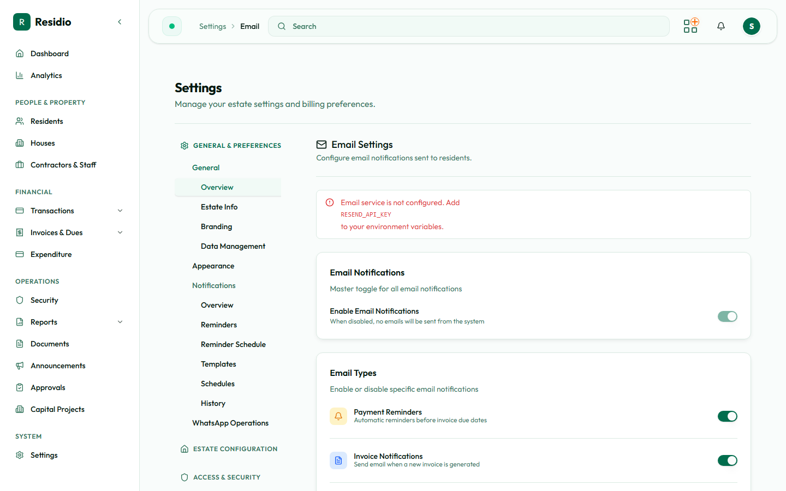

# Email and SMS channels

Residio sends resident communication over three channels: email, SMS, and in-app notification. Email and SMS both depend on an external provider, so both can be configured correctly in the dashboard and still fail at the provider.

## Email

Open **Settings → Messages → Email & sending**. The **Channels** section reports whether email is configured on the server before it shows any toggles — read that banner first. If it says email is not configured, no toggle there will produce a delivered message, and the fix is a server credential change by an engineer.

**Send email notifications** switches email on or off as a whole. In **Email types**, **Invoice notifications** and **Welcome emails** turn off one class of message without disabling the channel. **Payment reminders** there turns reminder emails on or off for both the automatic daily reminders and the manual run from **Reminders → Send now**; the automatic reminders as a whole are switched on or off under **Reminders** (see below). Changing these switches needs the manage general settings permission; without it they are shown disabled.

The **Testing** section of **Settings → Messages → Email & sending** (collapsed until you open it) holds the redirect and Debug Mode. It carries a *Needs attention* tag while messages are being redirected. While it is on, every email, SMS and WhatsApp message goes to the override contacts instead of the real recipient, so you can watch the system work without messaging residents. Choose a duration from 5 to 480 minutes when you turn it on; it switches itself off when the time is up, and it cannot be turned on while the override email or phone is blank. The override contacts have their own **Save Testing** and **Discard** buttons; Debug Mode and the test email act as soon as you use them. It replaces the old email-only debug switch, which skipped sending altogether.

The same **Testing** section is where you send a test email to an address of your choosing. **Settings → Messages → Reminders → Send now** triggers payment reminders by hand. Outside production these are redirected to the override contacts, and blocked if the override email is blank; in production they go to the real recipients unless Debug Mode is on.

## SMS

SMS is used for a narrower set of messages: two-factor codes, plus contact verification codes once the SMS provider is connected. SMS is currently switched off for emergency broadcasts, reminders, contact verification codes, and the WhatsApp fallback below until the SMS provider (Termii) is connected. It is more expensive and more intrusive than email, so it should not be the default channel for routine billing communication.

Until then, SMS has no settings of its own: **Settings → Messages → Reminders** offers only email and WhatsApp as channels for each step.

### SMS fallback for urgent WhatsApp messages

:::note[Currently off]
While SMS is switched off, this fallback does not run. A failed urgent WhatsApp send is reported as failed, with the WhatsApp error only.
:::

If the estate's active WhatsApp provider is Chatmaid or WAHA and a WhatsApp send fails for an **urgent** notification, Residio sends that notification by SMS instead. Both depend on a phone staying connected, and a message that does not arrive has no other way of being recovered.

- History records one entry for the message, on the **SMS** channel and marked as a fallback from WhatsApp. It will not also appear as a failed or successful WhatsApp send.
- If the SMS also fails, the message is reported as failed with both errors.
- Normal-priority messages, such as invoice reminders and receipts, are not sent by SMS in this case. They stay in the queue and are retried.
- Meta and Twilio never fall back to SMS.

:::warning[Emergency broadcasts reach everyone immediately]
A multi-channel emergency announcement bypasses the normal reminder cadence. While SMS is off, the SMS option is unavailable in the emergency dialog, and if SMS is somehow requested the results list shows SMS as failed with nothing sent. Confirm the message text and the recipient scope with the estate lead before sending.
:::

## Templates

**Settings → Messages → Message wording** lists the five emails residents actually receive, in its **Email** section, and lets you change their wording. Reusable announcement text is separate, under **Settings → Messages → Announcements → Templates**.

- Welcome email
- Payment receipt
- Payment reminder (manual "Send now" only)
- Payment reminder (escalating), sent by the scheduled reminders, with separate wording for each stage from friendly to overdue
- New invoice

Collection receipts and the messages to a collection's notified parties use fixed wording that is not listed here; see [Collections](../finance/collections.md). An email to a non-resident payer or notified party follows the same Testing redirect as every other email.

Choose **Edit** on an email to change its wording. What you can edit depends on the email:

- **Welcome email and payment receipt:** subject, heading, opening message and sign-off.
- **Payment reminder (manual) and New invoice:** subject, heading, sign-off and a closing message. The closing message is the paragraph near the end of the email, not the first paragraph, which stays as written.
- **Payment reminder (escalating):** for each stage (friendly, warning, urgent, final notice, overdue) a heading and subject, a message and a closing message.

Each field shows the built-in wording as grey placeholder text. A field you leave empty uses the built-in wording, and **Reset to default** on a field clears your edit. Paragraphs are separated by a blank line. The layout and the details the email shows (amounts, dates, invoice numbers) cannot be edited. This page needs the notifications manage permission, so everyone who can open it can edit.

Use variables such as `{{resident_name}}` or `{{amount}}` where the value should appear. The edit panel lists the variables each email allows, and a variable that is not on that list is rejected when you save. There is no way to add a new template, duplicate one or delete one.

A change takes effect on the next send. Invoice emails already waiting in the queue were rendered when they were queued, so they keep their old wording.

Before saving a wording change:

1. Read the **Preview**, which shows your saved wording with sample data.
2. Keep the subject short, because it is all some mail apps show.
3. Check the email reads correctly with a real name and amount, not only the sample.

### WhatsApp wording

The **WhatsApp** tab on the same page edits the text of two WhatsApp messages: the payment reminder and the payment receipt. It works the same way as the email wording (empty means the built-in text, **Reset to default**, a variable list, a Preview), with one message per event and a limit of 4096 characters. Announcements are written each time they are sent, so they are not listed.

Editing is available only while Chatmaid or WAHA is the connected WhatsApp provider. With Meta or Twilio, WhatsApp sends an approved template that is set in code, so the tab shows each template's name and the order its values are filled in, and nothing can be changed. A change takes effect on the next send.

## Reminders and schedules

**Settings → Messages → Reminders** turns automatic reminders on or off (**On or off**) and defines the steps (**Schedule**). Reminders are dispatched by a scheduled job rather than at the moment you save them, so a saved reminder that has not arrived yet is usually waiting for its next run, not broken. The Billing reminder days and the Email **Payment reminders** switch also limit what it sends; see [Billing and notifications](../settings/billing-and-notifications.md).

The scheduled job sends at most one reminder per invoice per day, so running it again on the same day (for example after a timeout) does not resend. A reminder day that the job missed is not caught up later. If the job cannot read the schedule, the invoices or an invoice's reminder history, it reports the run as failed instead of sending nothing silently.

Invoice reminders go out by email and WhatsApp only. SMS is switched off for reminders until the SMS provider (Termii) is connected, so an SMS step in a reminder schedule is skipped without an error. The default schedule is email only. The schedule editor offers Email and WhatsApp for each step; it does not offer SMS. A WhatsApp step reaches only residents who have opted in to WhatsApp.

## The notification queue

**System → Notification Queue** shows messages that Residio has created but not yet delivered. A healthy queue drains on each scheduled run.

| Queue state | Meaning |
|---|---|
| Small, draining | Normal |
| Growing steadily | The processing job is not running — check **System → Cron Status** |
| Stuck with failures | The provider is rejecting sends — check **System → Notification History** for the error |

The processing job runs every 15 minutes. A send that fails for a temporary reason, such as a provider timeout or rate limit, goes back into the queue and is tried again after 15 minutes, then 1 hour, 6 hours and 24 hours, up to 5 attempts in all. Each failed attempt is still written to history as failed. A failure that is not known to be temporary is not retried. Each message is claimed before it is sent, so two runs that overlap, for example a manual run during the scheduled one, never send the same message twice. A message left marked processing for more than 30 minutes, because a run stopped part-way through, goes back into the queue and is sent on the next run. If the first run had already handed it to the provider, the resident may receive it once more: email is de-duplicated, WhatsApp is not. A message that keeps getting stuck is marked failed after as many tries as its attempt limit. Any failed message can be retried by hand, which starts its attempt count again from zero.

Do not clear the queue to make a warning disappear. Clearing it discards messages residents were owed and destroys the evidence needed to diagnose the failure.

## History

**System → Notification History** is the record of what was actually sent, to whom, and when. Use it to answer a resident who says they were never notified, before assuming a delivery fault.
