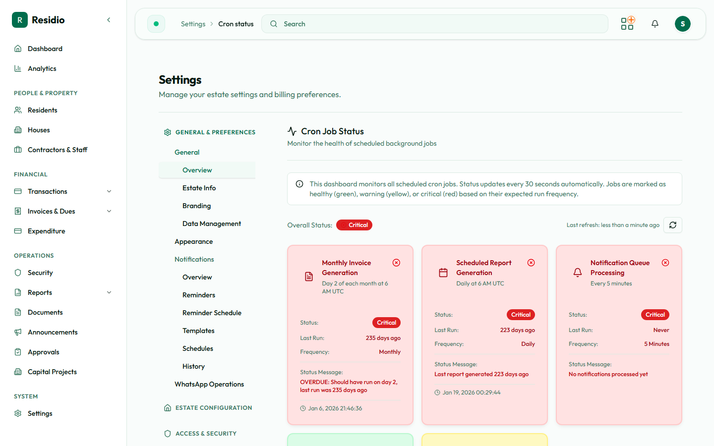

# Scheduled jobs

Much of Residio's routine work runs on a schedule rather than when you press a button. Invoices generate, reminders send, reports deliver, and mailboxes sync without anyone signing in. When something "did not happen", a scheduled job is usually the answer.

Monitor them from **Oversight → Scheduled jobs**. This moved out of Settings because job status is something you watch, not something you configure — see [Troubleshooting](../administration/troubleshooting.md).

## The schedule

Times are in UTC. Adjust for your estate's local time when reasoning about when residents will see the effect.

| Job | Runs | What it does |
|---|---|---|
| Payment cadence refresh | Daily, 00:00 | Recalculates resident payment cadence |
| WhatsApp retention purge | Daily, 00:15 | Removes expired WhatsApp sessions, processed messages, survey answers and outbound send records, and estate group members who match no resident record 30 days after they were last seen |
| WhatsApp estate group sync | Daily, 01:30 | Makes the saved list of estate WhatsApp group members equal to the list in WAHA |
| Invoice generation | Daily, 06:00 | Generates recurring invoices that are due |
| Report generation | Daily, 06:00 | Builds scheduled reports |
| Report schedule processing | Daily, 07:00 | Delivers reports to their subscribers |
| Payment reminders | Daily, 08:00 | Queues reminder messages for outstanding balances |
| Notification processing | Every 15 minutes | Sends what is waiting in the notification queue, retrying failed sends with a backoff, alerts admins to Chatmaid WhatsApp messages still unconfirmed after 15 minutes, and deletes WhatsApp statement PDFs 12 hours after they were made |
| Announcement publishing | Hourly | Publishes announcements whose scheduled time has arrived |
| Email import | Every 5 minutes | Reads the connected mailbox for bank alerts and statements, posts sender-checked alert credits at or below the auto-process limit as payments, and queues every other transaction for admin review |
| Approval expiry | Hourly | Rejects approval requests left pending past their 72-hour expiry and notifies the requester |

These schedules run as scheduled tasks on both the production and the staging server. On staging, every email, SMS and WhatsApp message a job sends goes to the contacts set on **Settings → Messages → Email & sending → Testing**, never to the real resident, staff member or report recipient; if the needed override contact is blank the message is blocked instead. See [Email and SMS channels](./email-and-sms) for how the override works.

The override does not reach three kinds of message, which staging can still send to real people: WhatsApp Assistant replies (they go to whoever messaged the number), sign-in emails such as password resets and invites (sent by Supabase), and Paystack payment receipts (sent by Paystack).

Invoice generation also has an off-server safety net: it checks production and staging and runs invoice generation only when the status page reports that job as Critical, so it normally does nothing.

Each scheduled run is also recorded in **Oversight → Action log** with its outcome, duration and any error. See [Access and system health](../settings/access-and-system-health).

A late fee job also exists as an endpoint but has never been on the schedule. If your estate charges late fees, confirm with an engineer how that run is triggered before assuming it is automatic.

## Reading the status page

**Oversight → Scheduled jobs** reports each monitored job as healthy, warning, critical, or unknown, alongside an overall status. It refreshes on its own while open.

| Status | What it means |
|---|---|
| Healthy | The job ran within its expected window |
| Warning | The job is overdue but not yet critical |
| Critical | The job has not run for long enough to affect residents |
| Unknown | No run has been recorded — normal for a new deployment, otherwise investigate |

A warning is a prompt to look, not a reason to act. Check the status page before manually generating invoices or resending notifications — a job that is merely late will otherwise run afterwards and duplicate your manual work.

### One job reports against the wrong expectation

The status page judges each job against a frequency it declares internally, and for notification processing that frequency does not match the schedule the platform actually runs.

| Job | Status page expects | Actually scheduled |
|---|---|---|
| Notification processing | Every 5 minutes (Warning after 10 minutes, Critical after 30) | Every 15 minutes |

The practical effect is that **notification processing often reports Warning or Critical**: the card measures the time since the last message was sent, so it goes Critical whenever 30 minutes pass with nothing to send. Read that particular card against the queue itself rather than the badge: if **Oversight → Notification queue** is draining, the job is working.

Treat this as a known reporting fault, not an outage. It is being tracked for repair.

## When a job has not run

1. Confirm the status on **Oversight → Scheduled jobs**.
2. Check whether the estate is in maintenance mode, which suppresses scheduled work.
3. Check the downstream surface — the notification queue, the import list, the invoice list — to see how much is outstanding.
4. If the job is genuinely not running, escalate to an engineer. Job scheduling is a deployment concern, not a dashboard setting.
5. Only after that, consider a manual run of the equivalent action.

Invoice generation catches up: the daily run generates the month's invoices on the configured day or on any later day of that month if the month has no scheduled run yet, and a scheduled run that an administrator cancelled is not recreated that month. The Invoice generation card reads the real run history, so it is Critical only when the month has no run after the configured day; if the scheduled run was cancelled it shows a warning instead and is not recreated. If automatic generation is switched off, the card reads healthy ("Automatic generation is off") instead, and no scheduled run is expected.

:::warning[Manual runs can duplicate]
Generating invoices manually while the scheduled run is merely delayed produces two sets. Confirm the job status first, and check the run history before triggering anything by hand.
:::

## Authentication

Scheduled endpoints are protected by a shared secret and reject any call that does not present it. They are not open URLs, and they are not something an administrator triggers by visiting a link. Manual runs are done from the dashboard actions that expose them — invoice generation has a run history for exactly this reason.

## Related

- [Email and SMS channels](./email-and-sms) for the notification queue
- [Gmail import and bank feeds](./bank-feeds-and-email-import) for the scheduled mailbox sync
- [WhatsApp operations](./whatsapp-operations) for the retention purge
- [Access and system health](../settings/access-and-system-health) for maintenance mode
