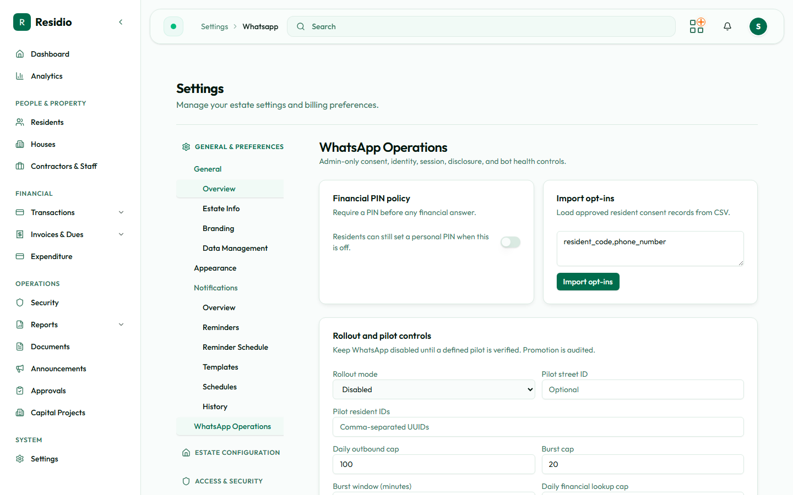

# WhatsApp operations

Residio connects to the WhatsApp Cloud API so residents can message the estate and receive answers, including balance and payment questions. Because the channel reaches residents directly and can disclose financial information, it ships **disabled** and is promoted deliberately.

All controls are on **Settings → WhatsApp**, and every promotion is audited.

The Financial PIN policy, opt-in import and operations console sit in a **Resident bot** section on that page. It is collapsed and labelled *inactive* unless the WhatsApp channel is on and the rollout mode is not `Disabled`; expand it to reach those controls.

## Connecting a provider

Before any message can be sent, the estate needs a WhatsApp provider connected. This no longer needs a developer or a redeploy — an admin with access to **Settings → WhatsApp** can connect, replace, or disconnect the provider directly from the connection card at the top of the page.

Choose one of three providers. Only one is active at a time — saving a different provider replaces the current one.

| Provider | Why choose it |
|---|---|
| **Meta** (recommended) | Connects directly to the WhatsApp Cloud API, with no per-message middleman. |
| **Twilio** | Adds a per-message cost on top of WhatsApp's own fees. Worth it mainly if the estate already runs other messaging through Twilio. |
| **Chatmaid** | A WhatsApp Web bridge: it pairs with an ordinary WhatsApp number on a phone you keep connected, rather than using the WhatsApp Cloud API. Worth it when the estate wants to use an existing WhatsApp number. It has no delivery guarantee when the phone is offline — read [Chatmaid: what to know before choosing it](#chatmaid-what-to-know-before-choosing-it). |

Whichever provider is chosen, have these details ready before you start:

| Provider | What you need |
|---|---|
| Meta | Access token, phone number ID, verify token, app secret |
| Twilio | Account SID, auth token, a WhatsApp-enabled from-number |
| Chatmaid | API key, webhook signing secret, and the from-number of the paired phone in international format (for example `+2348031234567`) |

These all come from the provider's own console, not from Residio. For Chatmaid, enter the paired phone's own number, not the phone ID shown in the Chatmaid dashboard — that ID differs between Chatmaid's test and live environments.

The from-number must not be the number that **Settings → Communications override** redirects WhatsApp to: the WhatsApp number there, or the override phone when the WhatsApp number is blank. A redirected message would be sent to the bridge phone itself and never reach anyone. The connection form shows the conflict under the from-number and disables **Save credentials**. The override form shows the same conflict under its own field and disables **Save**. Existing settings that already clash are not sent: the message is blocked with a reason that names the cause.

### The webhook callback URL

The connection card shows a **webhook callback URL** with a copy button. Paste this into the provider's console so it knows where to deliver incoming messages and status updates.

For Chatmaid, point the webhook at the callback URL shown on the card (it ends in `/api/whatsapp/webhook/chatmaid`). Residio rejects any call that is not signed with the webhook signing secret you saved, so the secret in Chatmaid and the one in Residio must match.

If you're connecting Meta, the console also asks for a **verify token**. Residio shows this to you once, immediately after you save the connection — copy it into Meta's console at that moment. It cannot be retrieved again afterwards; if you lose it, save the connection again to generate a new one.

:::warning[Copy the verify token immediately]
The Meta verify token is only ever shown once, right after saving. Navigate away before copying it and you will need to reconnect to get a new one.
:::

### Test the connection

Use the **Test connection** button to confirm the saved credentials actually work. Residio makes a lightweight call to the provider and reports back pass or fail. A failure means the provider rejected the stored credentials — double-check the values against the provider's console, particularly the access token, auth token or Chatmaid API key, and try again. It does not mean anything was sent to a resident.

For Chatmaid, the test also checks that the saved from-number is one of the phones paired to the Chatmaid account, and reports that phone's bridge status. It fails if the number is not paired, naming the phones that are, or if the paired phone is not connected to the bridge. Saving Chatmaid credentials runs the same paired-phone check and refuses a from-number that is not paired, or that belongs to a resident who has opted in to WhatsApp — the from-number must be the bridge phone itself.

### How credentials are kept

Secrets — access token, verify token, app secret, auth token, Chatmaid API key and webhook signing secret — are encrypted before they are stored, and Residio never displays them again after saving. The connection card only ever shows whether a credential is set, plus the non-secret details such as the phone number ID or from-number and who last saved the connection.

To change a secret, use **Replace credentials** and enter it again in full; there is no way to view or partially edit a stored secret.

### Disconnecting

**Disconnect** removes the saved connection. Once disconnected, Residio falls back to whatever WhatsApp credentials are set in the deployment's environment variables, if any are configured there. Use this if a connection was set up in error, or while handing a provider account over to a new administrator.

### Twilio: mapping templates to Content SIDs

If the estate uses Twilio, each approved message template also needs a Twilio **Content SID** before it can be sent. Residio only ever sends from a fixed, pre-approved list of template names — the Content SID mapping tells Twilio which of its approved content items corresponds to each of those names. Set this mapping from the connection card once Twilio is connected.

A template with no Content SID mapped fails to send rather than going out as unapproved free text — this is a deliberate compliance guard, not a bug to work around by leaving a mapping blank.

## Chatmaid: what to know before choosing it

Chatmaid works through a phone that stays paired to the bridge, so the estate's WhatsApp service is only as reliable as that phone's connection.

- **Messages are lost while the phone is disconnected.** Anything a resident sends to the number while the bridge is down never reaches Residio, and nothing is recovered when it reconnects. Residents who wrote in during an outage may need to be contacted.
- **Sending needs the bridge connected.** Before each send, Residio checks that the phone is connected; if it is not, the send fails with a "bridge is disconnected" error. (Residio re-checks at most every 30 seconds.)
- **Admins are alerted.** When Chatmaid reports the phone disconnected, admins receive an urgent notification linking to **Settings → WhatsApp**; a normal-priority notification follows when it reconnects. Re-pair the phone in the Chatmaid dashboard to restore service.
- **A sent message is not a delivered message.** Chatmaid accepts a message first and reports later whether it was sent or failed. Residio records each send and its outcome. When three messages fail within 10 minutes, admins receive a notification linking to **Settings → WhatsApp**. A message still unconfirmed 15 minutes after Chatmaid accepted it is treated as undelivered too: admins are notified by the next notification run, which happens every 15 minutes.
- **Urgent messages fall back to SMS (currently off until the SMS provider is connected).** See the SMS fallback section on the Email and SMS page.
- **Human takeover.** If someone on the estate team replies to a resident directly from the phone, the Assistant stays silent in that conversation for 30 minutes so the two do not talk over each other. The resident's messages during that time are still recorded and are not answered later.

## Turning the channel on

Connecting a provider does not by itself let messages flow. A separate **master on/off switch** on the WhatsApp settings page decides whether the channel runs at all — it defaults to **off** and must be switched on deliberately, even after a provider is connected and tested.

This is distinct from the rollout mode described below: the master switch decides *whether the channel runs*; rollout mode decides *who receives messages once it does*. Both must be set correctly for residents to receive anything.

## Rollout modes

| Mode | Who receives messages |
|---|---|
| `Disabled` | Nobody. Outbound is blocked entirely. This is the default. |
| `Pilot` | Only named residents, plus every resident on one nominated street. |
| `Estate` | All residents. |

Use **Rollout and pilot controls** to set the mode. In pilot mode you choose pilot residents by name from a searchable list (each entry shows the resident code and house, to tell same-name residents apart), a pilot street, or both — a resident matching either rule is included.

### Promote a pilot to the estate

1. Confirm the pilot has run long enough to see a full billing cycle.
2. Review the operations console for delivery failures and template errors.
3. Confirm the daily and burst caps are sized for the full estate, not the pilot.
4. Change the mode to `Estate`.
5. Record who approved the promotion. The change is written to the audit log.

:::warning[Do not skip the pilot]
Moving straight from `Disabled` to `Estate` sends the first real message to every resident at once. A template error at that point is not recoverable.
:::

## Consent and opt-ins

A resident only receives WhatsApp messages after an approved consent record exists. Invoice reminders and payment confirmations check this when the message is created, so a resident without consent gets no queued message at all (an invoice reminder run reports it as "recipient has not opted in"). The check is repeated at send time.

- **Import opt-ins** loads approved consent records from CSV in bulk.
- The operations console lists current opt-ins and any pending contacts awaiting confirmation. With the WhatsApp manage permission, each opt-in row has **Issue link code**, **Issue setup code** and **Reset PIN** (see [Issuing codes](#issuing-codes)).

Pending contacts are people who have messaged the number but are not yet matched to a resident record. Resolve them by confirming identity against the resident directory — never by guessing from the phone number alone.

### Identity check and privacy notice

The alerts opt-in above covers messages the estate sends. Before the assistant uses a resident's records to answer them, two more steps run in chat, for every number including imported opt-ins:

1. **Identity read-back.** On the first message from a matched number the assistant replies `This number is registered to <First> <L.> on <Street>. Is that you?` with `1. Yes, that's me` and `2. No, not me`. It asks again if the resident's name or street changes.
2. **Privacy notice.** After `Yes`, the resident gets a short message with the full notice attached as a PDF, and replies `1. Accept` or `2. Decline`. A request sent before this, such as `OWE`, is answered after Accept, still behind the PIN policy. A resident who declines gets the estate office contact and can reply `ACCEPT` at any time; no records are used until then.

Every decision (identity confirmed or disputed, notice accepted or declined) is logged permanently with the number, the notice version and the WhatsApp message that carried it. `STOP` and `START` keep their meaning for alerts.

**Privacy notice** in the Resident bot section holds the notice text and version. Changing the version asks every resident to accept again. A text change is refused unless the version changes too, so each accepted version covers one wording. The text needs exco sign-off before launch.

If a holder answers **No, not me**, the number is marked **disputed** in Pending contacts, admins are notified, and the assistant shows no details for it. After checking, an admin with WhatsApp manage permission clicks **Clear dispute**; the number then gets the identity read-back again on its next message. A link code does not lift a dispute; only clearing it does.

### Linked numbers

A number linked to a resident (by matching their record or with a link code) keeps that link only while it is still in force:

- **Changing a resident's phone deactivates the old number's link.** When a resident's primary or secondary phone is edited, the links for any number removed from their record stop working. Whoever holds the old number is treated as an unknown contact until it is linked again with a fresh link code.
- **Archived and suspended residents are not answered** over a linked number.
- **Financial answers need a verified link.** A link is verified when the number is the resident's primary or secondary phone, or when it was linked with a link code — for example a spouse's phone. A number linked with a code before this rule shipped keeps its verified link only if its pending-contact record is still attached to that resident; any other number linked that way, if it is not on the resident's record, needs a fresh link code. Any other linked number gets estate announcements and notices only. Archived and suspended residents never get financial answers.
- **Deactivated links get nothing.** A deactivated link receives no announcements or notices, and shows as **Deactivated** in the opt-in registry. A link code re-activates it.

## Financial PIN policy

**Financial PIN policy** controls whether a PIN is required before Residio answers any financial question over WhatsApp.

- When the policy is **on**, every resident must enter a PIN before a balance, invoice, or payment answer is returned. A resident without a PIN is asked to set one by replying `PIN` followed by 4–6 digits of their choice.
- When it is **off**, residents may still set a personal PIN for themselves.

The policy is **on** by default. Leave it on for estates where phones are commonly shared.

Wrong PINs lock financial answers in two steps. Both refuse even the correct PIN while they last:

- **3 wrong PINs in a row** lock the PIN for **15 minutes**. The resident is told the time it unlocks, and the lock lifts on its own. A correct PIN before the third wrong one resets the count.
- **6 wrong PINs within 24 hours** lock the PIN until the estate office resets it with **Reset PIN**. This lock never lifts on its own. A correct PIN does not reset this count.

Every wrong-PIN and lock reply ends with the estate office phone, email and office hours from **Settings → Estate info**, or with nothing if neither phone nor email is set.

### Setting a PIN

A resident sets their first PIN with a 6-digit **setup code** from the estate office. Setup codes are issued from the opt-in registry with **Issue setup code**, usually in a batch as each street joins the pilot. Turn the PIN policy on for a street only after its codes are out.

:::note[Rolling out]
The dashboard issues setup codes now. Until the WhatsApp Assistant is updated to ask for them, a resident without a PIN can still set one by replying `PIN` followed by 4–6 digits. This includes a resident whose PIN you just reset, so reset a PIN only when the resident is ready to set the new one straight away.
:::

### Issuing codes

Each opt-in row has two code actions. Both need the WhatsApp manage permission and ask you to confirm the resident's identity first.

| Action | What the code does | Valid for |
|---|---|---|
| **Issue link code** | The resident replies `LINK` followed by the code from a number, and that number is linked to them with financial answers | 15 minutes |
| **Issue setup code** | Lets the resident set their first WhatsApp PIN. Issuing a new one cancels any earlier unused setup code | 10 minutes |

The code is shown **once**, with its expiry, in a dialog with a **Copy** button. Residio stores only a one-way hash of it, so closing the dialog loses it for good: issue a new one if needed. Each code works once. A setup code cannot be used with `LINK`. Issuing a code is written to the audit log without the code.

**Confirm identity before issuing any code.** Do it in person, or by calling the resident from the estate phone and checking two facts from their record (house number, resident code, last payment amount). A call-back to the WhatsApp number alone does not count.

### Reset PIN

**Reset PIN** on the opt-in row replaces a forgotten PIN or unlocks a resident early. Use it only after confirming identity as above, because whoever receives the new setup code can set the PIN. It asks for confirmation, then:

1. clears the PIN, the wrong-PIN count and any lock;
2. signs the resident's open WhatsApp chats out of the PIN, so the next financial question asks for a PIN again;
3. issues a setup code, valid for 10 minutes and shown once.

The reset is written to the audit log. The PIN and the code are never recorded.

## What residents see

Residents reply with numbers or fixed keywords; the Assistant does not interpret free text. Every reply that is an answer ends with `Reply 0 for menu or 9 to contact the estate office.`

The main menu opens with `Hi <first name>, what would you like to do?` and lists:

| Item | Shown when |
|---|---|
| 1. Financial standing | The resident is billed for a property. Marked *PIN protected*, or *unlocked* once the PIN is entered |
| 2. Latest estate notices | A published estate-wide announcement exists. Shows the 3 latest; the resident replies with a number to read one in full |
| 3. How to pay | **Payment instructions** is filled in (see below) |
| 4. Alert settings | Always. Turning *All estate WhatsApp messages* off works like replying `STOP`. A resident billed for a property also sees *Payment reminders*, ON or OFF |
| 5. Update email | Always |
| 9. Contact the estate office | The estate phone or email is set on **Settings → Estate & Property → Estate Details** |

**Financial standing** lists What I owe, Recent payments (the last 5), Statement (this month, this year, last 6 months, last 12 months or all time), Wallet, Receipt, Report a payment and Clearance certificate. Only this item, and Update email, ask for the PIN. A resident billed for more than one property is asked which one once per session, sees it in every heading, and can change it under **8. More**.

A statement reply is a text summary ending `Reply PDF to download the full statement.` On `PDF`:

- **Up to 40 rows:** the account statement PDF is attached in chat. It is stored privately, Chatmaid is given a link that works for 1 hour, and the file is deleted 12 hours later. If Chatmaid reports the send failed, it is sent once more with a fresh link.
- **Over 40 rows:** the resident is offered email to their address on file, shown masked (`a***@gmail.com`). On `1` the email is queued and arrives with the PDF attached within 15 minutes, through the notification queue, so the communications override applies to it.
- **No email on file:** the resident is told so, and the request appears under **Statement requested, no email** in the operations console until an email is added and the statement is sent.

### Account actions

Beyond answers, a resident can make four changes from chat. Each is recorded in the audit log with the resident as the actor, and nothing else can be changed over WhatsApp.

- **Payment reminders** (Alert settings, item 2): turns payment and invoice reminders on WhatsApp off or on. Turning off asks `Reply 1 Yes, 2 No` first. Announcements, security alerts and the STOP command are unaffected, and so are email and SMS reminders.
- **Update email** (main menu item 5, or `EMAIL`): the resident types an address, a 6-digit code is emailed to **that** address, and the address is saved and marked verified only when the code comes back. The code expires in 30 minutes, at most 3 codes are sent an hour, and 5 wrong codes cancel it. The old address is emailed that the address changed, showing the new one masked. Statements queued for want of an email are sent as soon as the address is verified, and clear from the operations console.
- **Receipt** (Financial standing, item 5, or `RECEIPT`): lists the last 5 payments; picking a verified one sends its receipt as a PDF, handled like a statement PDF (private link for 1 hour, file deleted after 12 hours, one retry). A payment still awaiting verification gets `A receipt is available once this payment is verified.` The list and each PDF are disclosures and count toward the caps.
- **Report a payment** (item 6, or `REPORT`): asks for the amount, the date and the bank narration or reference, shows a summary, and files it on `1`. At most 3 reports a day; the date must be within the last 90 days and not in the future; the same amount, date and property cannot be reported twice. The report is a pending payment that appears in the resident's *Awaiting verification* figure, plus a request in [Approvals](../operations/approvals-and-announcements). Approving it makes it a real payment: verified, credited to the wallet and allocated to invoices; rejecting it, or no decision in 72 hours, closes it. Either way the resident is told by WhatsApp. A screenshot sent during a report is acknowledged, but WhatsApp does not pass the image to Residio: the estate office sees it on the estate phone, and the time it arrived is noted on the payment.
- **Clearance certificate** (item 7, or `CLEARANCE`): per property. A resident who owes money is told the amount. A resident who owes nothing files a request in Approvals (only one can wait per property: a second resident on the same property is told a request for the property is already waiting, with the estate office line, and the certificate goes to whoever asked first); on approval the certificate is issued, sent to them in chat, saved to Documents under *Clearance certificates* with the property, and copied on WhatsApp to the members of the group chosen under **Settings → Billing → Clearance certificate copies** (see [Billing and notifications settings](../settings/billing-and-notifications)). The same copies go out for every certificate issued from the move-out screens.

- `0` goes back one level; `MENU`, `HI` or `HELLO` show the main menu; `CANCEL` abandons the current step; `LOCK` ends an unlocked session.
- `9`, `HELP`, `AGENT` and `CONTACT` give the estate office line: phone, email and office hours from Estate Details.
- Keywords such as `OWE`, `PAYMENTS`, `STATEMENT`, `WALLET`, `PAY`, `NEWS`, `RECEIPT`, `REPORT`, `CLEARANCE`, `REMINDERS` and `EMAIL` jump straight to an item. Add the estate's own phrasing under **Extra keywords**.
- A reply the Assistant does not understand gets `I didn't catch that.`; from the second in a row it adds the estate office line. Voice notes, images and stickers get a request to type instead.
- After 15 minutes without activity the session ends: the next message says so, and the chosen property and the PIN unlock are forgotten.
- If a lookup fails, the resident is told nothing was shown or changed and to try again shortly, with the estate office line.

### Assistant replies

The **Assistant replies** card in the Resident bot section holds the text the Assistant sends:

- **Payment instructions**: the bank, account number and narration wording sent for *How to pay*. While it is empty, *How to pay* is hidden.
- **Extra keywords**: one `phrase = item` per line, for example `service charge = owe`. Items are `owe`, `payments`, `statement`, `wallet`, `pay`, `notices`, `contact`, `email`, `reminders`, `report`, `receipt` and `clearance`.

Each saves on its own and is written to the audit log.

## Rate caps

Caps protect residents from a runaway loop and protect the estate from provider throttling.

| Cap | Purpose |
|---|---|
| Outbound daily cap | Maximum messages sent in a day |
| Outbound burst cap | Maximum messages within the burst window |
| Burst window (minutes) | The window the burst cap is measured over |
| Financial lookup daily cap | Maximum financial answers returned in a day, across the whole estate (default 500) |

Each resident is also limited to 20 financial answers a day. Only the Financial standing answers count toward either financial cap (What I owe, Recent payments, Statement, Wallet, the Receipt list and each receipt PDF, and the Clearance certificate check), including each statement PDF and email; How to pay, notices and the contact line do not. Both reset at midnight Lagos time, and the resident is told which limit was reached.

When a cap is reached, further sends are blocked and the event is counted in the console as a cap limit event. Repeated cap events mean the cap is wrong for the estate size or something is sending in a loop — investigate before raising the number.

## The operations console

The console on the same page shows today's activity: inbound messages, outbound messages, delivery failures, template errors, and cap limit events. It also lists undelivered messages, active sessions and the disclosure log.

The **undelivered messages** list covers the last 7 days. It shows each WhatsApp message the provider reported as failed, or that Chatmaid accepted but never confirmed as sent within 15 minutes. Each row shows the time, the resident (when known), the masked number, whether it was a reply or a notification, the provider's reason, and the id of the resident message it answered. Those residents may not have received the message, so contact them another way. Residio does not resend these messages automatically.

The **Statement requested, no email** list shows residents who asked for a statement too long for chat and have no email on file. Add their email to clear it.

The **Clearance certificate copies not sent** list shows each copy of an issued certificate that did not reach a member of the copy group (not opted in, no WhatsApp number, or the provider refused), with the reason and the number of tries. With the WhatsApp manage permission each row has a **Retry**, which sends it again with a fresh link. A failed copy never holds up the resident's own certificate.

The **disclosure log** records every occasion on which financial information was released over WhatsApp, with its channel: `chat` for an answer, `pdf` for a statement or receipt PDF sent in chat, and `email` for one sent by email. Treat it as an audit surface: it is the evidence that a disclosure was authorised, and it should never be cleared to tidy a screen.

## Data retention

WhatsApp operational state is short-lived by design and purged on a daily schedule.

- Sessions are removed after they expire, by default the next day.
- Processed message records are removed after their expiry, by default two days.

The cleanup runs automatically shortly after midnight, documented on the Scheduled jobs page in this section.

## Troubleshooting

| Symptom | Check |
|---|---|
| Nothing sends | No provider is connected, the master switch is off, rollout mode is `Disabled`, or the recipient is outside the pilot scope |
| One resident receives nothing | No approved opt-in record for that resident |
| Sends stop partway through a day | A daily or burst cap has been reached |
| Financial questions go unanswered | The resident has no PIN set while the PIN policy is on, or the number is linked but is neither on the resident's record nor linked with a link code |
| Resident is told their PIN is locked until a time | Three wrong PINs in a row; the lock lifts at that time, or earlier with **Reset PIN** |
| Resident is told the estate office needs to reset their PIN | Six wrong PINs within 24 hours; only **Reset PIN** lifts it |
| Resident forgot their PIN | Confirm identity, then use **Reset PIN** and give them the setup code |
| A resident says their email code does not work | It expires after 30 minutes, 5 wrong codes cancel it, and only 3 codes are sent an hour. They reply `EMAIL` to start again |
| A resident's payment report never shows up | Check **Approvals** for a *Payment Reported on WhatsApp* request. Approving it needs both the approvals and the verify payments permissions |
| A clearance certificate copy did not reach an estate official | See **Clearance certificate copies not sent** in the console; usually the official has not opted in |
| A link or setup code is not accepted | It expired, was already used, or a newer setup code replaced it. Issue a new one |
| Test connection fails | The provider rejected the saved credentials — recheck the access token or auth token against the provider's console. For Chatmaid, the from-number may not be a paired phone, or the paired phone is not connected to the bridge |
| A WhatsApp send is blocked with "is the WhatsApp from-number" | The communications override points WhatsApp at the bridge phone itself. Change the override WhatsApp number (or the override phone, if the WhatsApp number is blank) under **Settings → Communications override** |
| Chatmaid sends fail with "bridge is disconnected", or you received a WhatsApp disconnected alert | The paired phone has lost its connection — re-pair it in the Chatmaid dashboard |
| Assistant stops replying in one conversation (Chatmaid) | A team member replied from the phone within the last 30 minutes; the Assistant resumes afterwards |
| Twilio template fails to send | No Content SID mapped for that template name — map it on the connection card |
| Residents say the Assistant did not reply, or you received a "replies are failing to deliver" alert (Chatmaid) | Check **Undelivered messages** in the console for the provider's reason, and the paired phone in the Chatmaid dashboard |
| Delivery failures climbing | Provider credentials or template approval — escalate to an engineer |
| Inbound messages ignored | Webhook verification is failing at the provider — escalate to an engineer |
