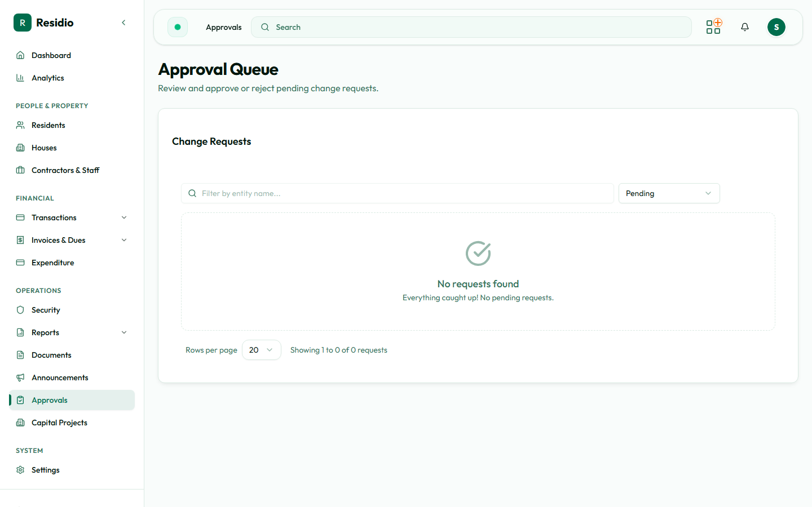

# Approvals and announcements

## Approvals

Open **Approvals** from the dashboard or sidebar. Review the source record, evidence, submitter, amount, and history before approving or rejecting an item. On a phone, each request is shown as a card with the same status, details and **Approve** / **Reject** buttons as the table row.

Use the approval decision that matches the evidence. If the record is incomplete, reject it with a useful reason or leave it pending according to the estate process.

When a request is approved (and its change has been applied) or rejected, the person who submitted it receives an in-app notification with the outcome and, for a rejection, your reason. Nobody is notified for a decision you make on your own request.

A request that nobody decides within 72 hours of being submitted is rejected automatically (the review note reads Auto-rejected: No response within 72 hours), and the person who submitted it receives an in-app notification that it expired. Requests that were already pending before this was introduced do not expire.

## Announcements

1. Open **Announcements → New Announcement**.
2. Choose the category and priority.
3. Write a short, action-oriented title.
4. Add the message, audience, and schedule.
5. Preview the result before publishing.
6. Publish immediately only for time-sensitive communication.

:::tip[Clear communication]
Put the action and deadline in the first two lines. Use emergency priority only when the message needs immediate attention.
:::
