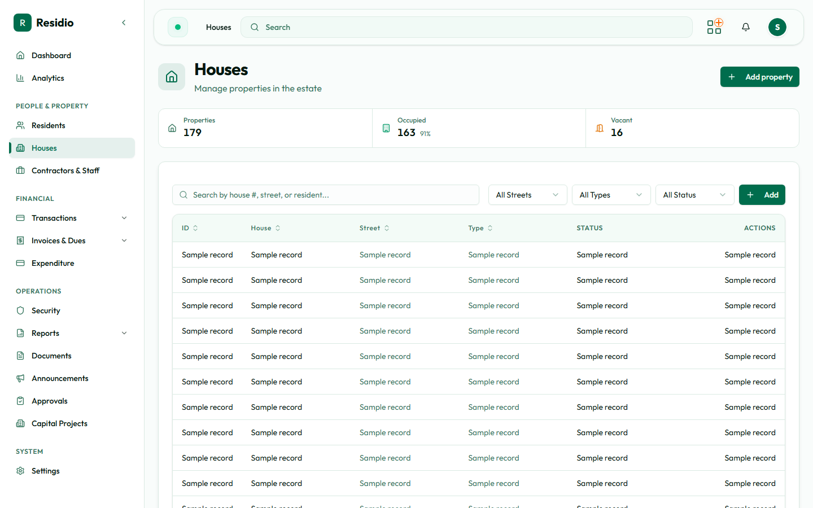

# Houses and occupancy

Open **Houses** to inspect the property registry, current occupancy, street, house type, and linked residents.

## Find a property

1. Search by house label or short name.
2. Filter by street, house type, occupancy, or active status.
3. Open the property to review current residents and ownership history.

## Short names

A short name is the street code plus the house number, for example `GLB-14`. Residio creates it
for you and you can edit it before saving. A space in the house number becomes a hyphen, so
`14 F1` on street `GLB` gives `GLB-14-F1`. Short names may use only letters, digits, dots and
hyphens, and must start with a letter or digit; the form shows "Use letters, digits, dots and
hyphens only" otherwise. Invoice generation needs this, and a name that breaks it stops the
whole estate's invoice run. Names already saved are never rewritten.

## The house page

The header shows the house, its type and one status line: occupancy, the number of active
residents and the house's debt status: Outstanding, Arrears, Paid in Full or Credit, with the
amount owed beside it when there is one. If the status cannot be loaded, the line says "Debt
status unavailable" rather than showing nothing owed.

The page opens on **Residents**. **Billing** holds the payment status and yearly ledger, and
**History** the ownership and occupancy timeline (the latest 100 events). Each tab is kept in the
address as `?tab=`, so a link opens the same tab.

Each resident row has one main action and a **…** menu for the rest:

| Role | Actions | Permission |
| --- | --- | --- |
| Owner-Occupier, Renter | Move Out | *assign residents* |
| Property Owner, Developer | Transfer | *update houses* |
| Property Owner, Developer | Remove (ownership) | *update houses* |
| Occupant and other secondary roles | Edit role, Promote (Occupant only), Remove from house | *assign residents* |

An Occupant is always sponsored by the house's Owner-Occupier or Renter. **Link Existing** and
**Edit role** fill that sponsor in, and refuse an Occupant while the house has neither.

**Link Existing** needs *assign residents* and **Add New** needs *create residents*. **Edit** needs
*update houses*. **Delete house** is in the **…** menu beside Edit and needs *delete houses*; it
stays disabled, with the reason shown, until every resident has been removed, and it asks for
confirmation before deleting.

## Occupancy is not a manual label

Occupancy is derived from active resident-house assignments. If the displayed state is unexpected, inspect the assignment history and active roles before editing the house itself.

## Add a house

Use **Add House** for a new property. Select the correct street and house type, enter the estate display label, review the details, and save. Do not reuse an existing label.

## Identifiers that need confirmation

Some properties came from the estate's manual register, where a `?` marks a character the
recorder was not sure of — `IBB-3?F?`, for example. Residio keeps the identifier exactly as it
was recorded and tracks the doubt separately, so the register stays faithful and nothing that
already references the property breaks.

- A property whose identifier is doubted carries a **Needs confirmation** badge on the houses
  list and on its own page. Hover the badge to read what is uncertain.
- The **Identifier** filter on the houses list narrows to *Needs confirmation* or *Confirmed*.
- **Unconfirmed** opens the work queue at `/houses/unverified`: every property still awaiting
  confirmation, with the note recorded against each one.

Confirming an identifier records that the value is right as recorded and removes the property
from the queue. It does not change the identifier — if the value itself is wrong, edit the
house instead. Confirming requires the *update houses* permission; without it the queue is
still readable, but the confirm button is not shown.

When adding or editing a house, tick **Identifier needs confirmation** and describe what is
uncertain if you are recording a house number you could not verify.

## New, never occupied

Tick **New, never occupied** on the house form for a brand-new house that has never had a resident. While it is vacant, it is not billed occupant dues such as security dues. Assigning its first Renter or Owner-Occupier clears the tick automatically, and the change is written to the audit log.
