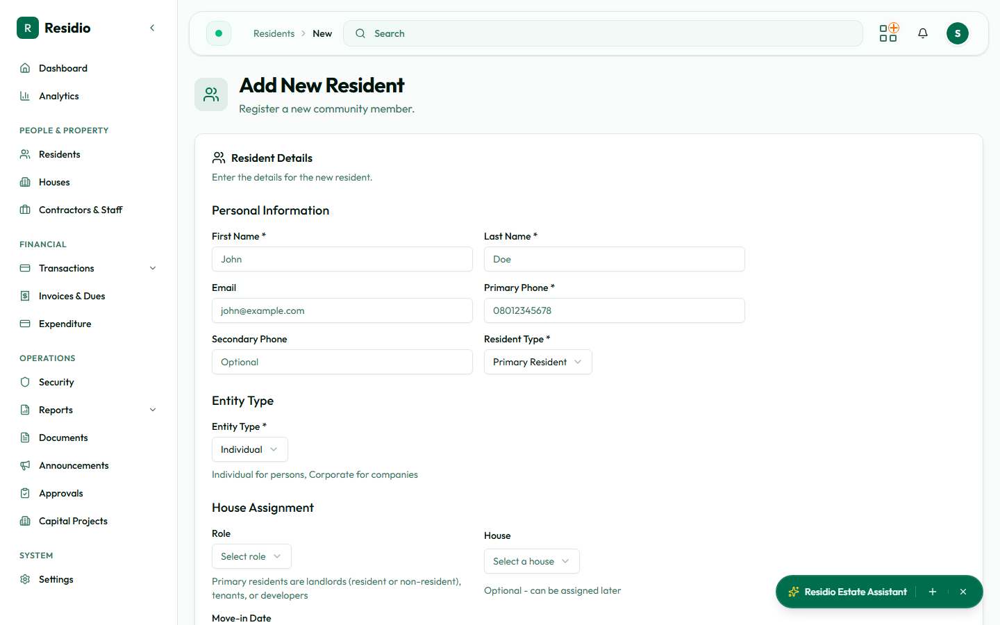

# Add and assign a resident

Use this workflow when a new resident needs an account and a property assignment.

## Before you begin

- Confirm the person does not already exist in **Residents**.
- Confirm the house and the intended resident role.
- Have a reliable phone number or email for future verification.

## Create the record

1. Open **Residents → Add Resident**.
2. Enter the identity and contact details.
3. Select the resident type and occupancy role.
4. Add the house assignment when the form provides it, or save and assign it from the resident detail page.
5. If you hold the **Manage General Settings** permission (`settings.manage_general`), choose how the resident's messages are handled under **Communications override** (see below). Everyone else does not see this control.
6. Review the summary carefully, then select **Create resident**.
7. If a message says the person may already be a resident, follow **When Residio finds an existing resident** below.
8. Record the generated resident code in the approved estate process.

### Sponsors

Some roles must be sponsored by a resident of the same house. An **Occupant** is always sponsored by the house's active **Owner-Occupier** or **Renter**; the form fills that person in for you. If the house has neither, an Occupant cannot be added until one is assigned. Domestic staff, caretakers and contractors are sponsored by the house's Property Owner, Owner-Occupier or Renter, chosen in the **Sponsor** field. When a resident adds an Occupant from their own household, they become the sponsor.

When the sponsor moves out, Residio removes the Occupant from the house as part of the same move-out.

### Communications override

This control decides whether email, SMS and WhatsApp messages for this resident are redirected to the override contacts set in the communications override settings.

- **Follow environment default** (the default): messages are redirected everywhere except production, where they go to the real recipient.
- **Use override contacts**: messages for this resident are always redirected while the override applies.
- **Send to real recipient**: messages go to the resident even outside production, for example from Stage. Use this only for a tester who should receive real messages. Debug Mode still redirects.

Users without **Manage General Settings** (`settings.manage_general`) cannot see or change this control. When they create a resident, any value submitted for it is silently ignored and the resident follows the environment default. When they edit an existing resident, an attempt to change it is refused with a permission error and nothing is saved. Changes appear in **Audit Logs**.

### When Residio finds an existing resident

Before it saves, Residio looks for a resident with the same email, or with both the same phone number (in any format, primary or secondary) and exactly the same name or company name (ignoring capital letters and spaces at the ends). A phone number alone or a name alone is not enough, because families and companies share phones. Residio never merges or links anyone on its own.

The message lists each match with its resident code, why it matched and the houses already linked. Choose one:

- **Link house to existing resident**: adds the house and role from the form to that resident, and creates no second record. This needs a house and a role on the form, and the **Assign resident to house** permission.
- **Create new resident anyway**: saves a separate resident. Use it only when you are sure it is a different person or company.
- **Cancel**: go back to the form.

Existing duplicates are not changed by this check.

:::warning[Duplicate prevention]
Do not create a second record because a resident has changed phone number, role, or house. Update the existing record instead.
:::

## After creation

Open the new resident profile and confirm the house, role, active status, and financial standing. The create event should appear in **Audit Logs**.
