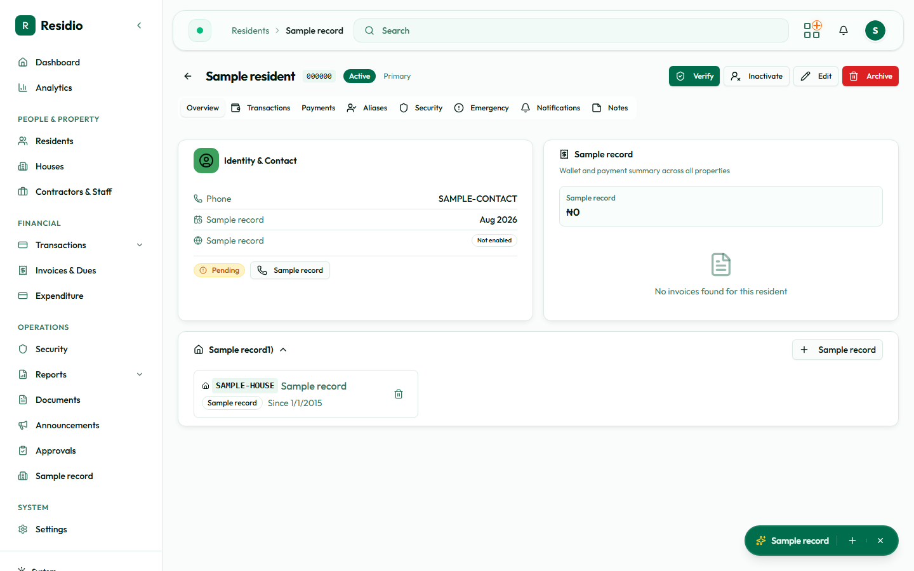

# Resident details

The resident profile is the best place to understand one person across identity, property, finance, and activity.

## Tabs

- **Overview:** identity and contact details (including the emergency contact), contact verification status, the financial summary, and house assignments.
- **Money:** wallet balance and adjustments, wallet payment batches, the wallet ledger, payment history (20 per page), and payment aliases.
- **Security:** security contacts registered by the resident.
- **Notes:** internal notes, for users who can view notes.

The selected tab is part of the page address (`?tab=money`), so the browser back and forward buttons move between tabs and a link can open a specific tab. Older links to the Transactions, Payments or Aliases tabs open **Money**; links to Emergency or Notifications open **Overview**.

## Actions and permissions

Buttons appear only for users who hold the permission the action needs:

| Action | Permission |
| --- | --- |
| Edit, Inactivate / Reactivate (under **More**) | `residents.update` |
| Archive (under **More**) | `residents.delete` |
| Verify contact | `residents.verify` |
| Link house, Move out, Transfer, Remove assignment | `houses.assign_resident` |
| Add, edit, activate or delete a payment alias | `residents.update` |
| Wallet adjustment, settle invoices from the wallet, prepay future months | `billing.manage_wallets` |
| Record payment | `payments.create` |

**Verify contact** marks every unverified contact detail (email and phone) as verified by an admin, and the resident as verified, after a confirmation dialog.

Use the edit action only when the source information has been verified. Changes to assignments can affect billing and access decisions.

## Safe update sequence

1. Open the resident from the directory.
2. Confirm you are on the correct record by resident code and house.
3. Change only the fields supported by the current source document.
4. Save once and wait for the success notification.
5. Refresh the profile and confirm the new value.
