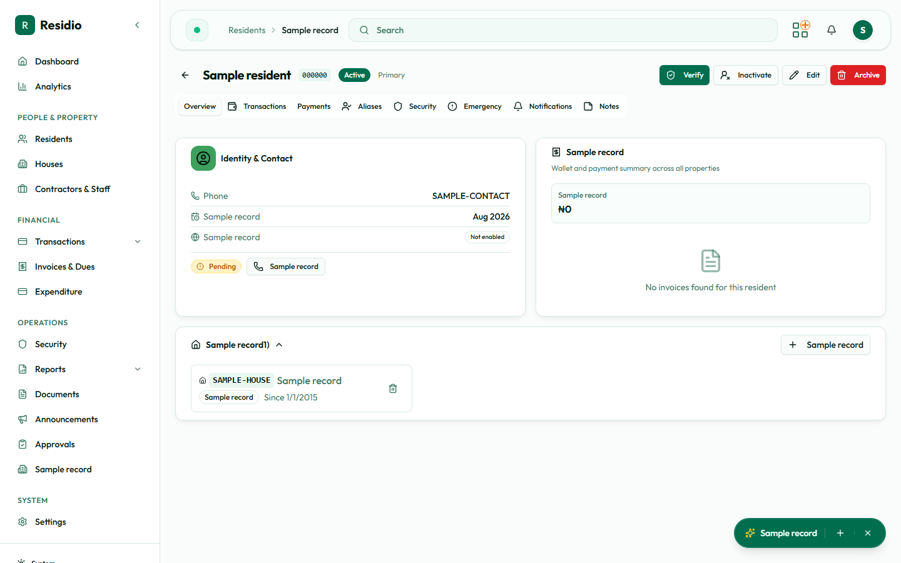

# Resident details

The resident profile is the best place to understand one person across identity, property, finance, and activity.

## Tabs

- **Overview:** identity and contact details (including the emergency contact), contact verification status, the financial summary, and house assignments.
- **Money:** wallet balance and adjustments (the balance is the total of the resident's wallets, with one line per charge category: Dues, Development Levy, Transformer Fee; an adjustment changes the Dues wallet; **Transfer credit** moves credit to another wallet of the resident or to a resident linked to the same house, and a transfer line in the ledger has **Reverse**), wallet payment batches (from the Dues wallet, so only Dues invoices are listed) (tick invoices one by one, use the header checkbox to select all, or **Select what the wallet covers** to pick the oldest invoices the balance can pay, including the one that only partly fits), and the wallet ledger, which also lists payments that credited the wallet and shows monthly invoice debits as one line per billing item per year (expand a line to see the months). Pending and failed payments, which credit nothing, show in an **Unposted payments** list above the ledger. Payment aliases open from the **Payment aliases** button. **Write off bills** writes off open bills (see below). On wide screens the ledger sits on the left and the balance and actions on the right.
- **Security:** security contacts registered by the resident.
- **Notes:** internal notes, for users who can view notes.

The selected tab is part of the page address (`?tab=money`), so the browser back and forward buttons move between tabs and a link can open a specific tab. Older links to the Transactions, Payments or Aliases tabs open **Money**; links to Emergency or Notifications open **Overview**.

## Actions and permissions

Buttons appear only for users who hold the permission the action needs:

| Action | Permission |
| --- | --- |
| Edit, Inactivate / Reactivate (under **More**) | `residents.update` |
| Archive (under **More**) | `residents.delete` |
| Merge residents (under **More**) | `residents.merge` (super admin only) |
| Verify contact | `residents.verify` |
| Link house, Move out, Transfer, Remove assignment | `houses.assign_resident` |
| Add, edit, activate or delete a payment alias | `residents.update` |
| Wallet adjustment, settle invoices from the wallet, prepay future months | `billing.manage_wallets` |
| Transfer credit, reverse a transfer | `billing.transfer_wallet_credit` |
| Write off bills, undo a write-off | `billing.write_off_invoices` (super admin and chairman) |
| Record payment | `payments.create` |

**Verify contact** marks every unverified contact detail (email and phone) as verified by an admin, and the resident as verified, after a confirmation dialog.

**Move out**, **Transfer** and **Remove assignment** on a linked house each open a confirmation dialog that names the resident and the house affected; nothing changes until you confirm.

## Write off bills

Use **Money → Write off bills** when the Exco agrees to write off old dues, for example after a settlement. The resident then owes nothing on the bills you write off.

1. Read the list. It shows the resident's open bills (unpaid or part paid), oldest first, in one group for each year. The amount on each line is the unpaid balance.
2. Tick the bills to write off. The header tick box selects all bills. You can also use the smart buttons:
   - **Oldest bills up to this amount**: type the agreed amount in **Agreed write-off ₦**. The oldest bills that fit in the amount are selected. A message tells you if they make the exact amount or the difference.
   - **Keep newest bills for this payment**: type the payment in **Payment ₦**. The newest bills that the payment pays in full are not selected. All other bills are selected.
   - One button for each year adds the bills of that year. **Clear** removes all ticks.
3. Read the bar at the bottom. It shows the number of bills selected, their total, and what the resident still owes after the write-off (and after the payment, if you typed one).
4. Select **Write off selected**. Choose a reason (**Exco settlement**, **Hardship** or **Other**) and type a note of at least 5 characters. Then select **Write off**.

A bill with nothing paid gets the status **Written off**. A part-paid bill keeps the amount that was paid and shows as **Written off**; only its unpaid balance is written off, so the paid amount stays in the collection figures. Each write-off makes an audit log entry and a line in the **Write-offs** report.

To undo a write-off, open one of its bills from **Invoices & Dues** and select **Undo write-off**. All bills of that write-off go back to how they were. The undo is refused if a bill changed after the write-off, for example if a payment was put on it.

## Merge residents

Use **More → Merge residents** when one person has two resident records. The merge moves everything from the duplicate to the record you keep, then archives the duplicate. It cannot be undone from the app.

1. Choose the other record. Likely duplicates (same phone, same house or a similar name) show first. If the record is not in that list, search all residents by name, resident code, house or phone. Then choose which of the two records to keep.
2. Read the preview. It lists everything that will move (house links, invoices, payments, the wallet balance and its transactions, WhatsApp opt-ins and links, notification preferences, documents, notes and the rest), the kept wallet's new balance and the combined account balance.
3. If the preview shows a reason the merge cannot go ahead, fix that first. The merge stops when both records are linked to the same house (end one link with the move-out or unassign tools) or both records have a portal login (unlink one).
4. Check any warning about a payment or an invoice that may have been entered on both records, and void the extra one first.
5. Where the email or phone numbers differ, choose which value the kept record should have. The kept record's value is selected by default. Every other detail stays as on the kept record.
6. Type the kept record's resident code and press **Merge residents**.

The duplicate's WhatsApp PIN is cleared, not copied. If the kept record has no PIN, the resident sets a new one.

A merged record shows **Merged into** and the kept record's code at the top of its page, with a link to the kept record.

Use the edit action only when the source information has been verified. Changes to assignments can affect billing and access decisions.

## Safe update sequence

1. Open the resident from the directory.
2. Confirm you are on the correct record by resident code and house.
3. Change only the fields supported by the current source document.
4. Save once and wait for the success notification.
5. Refresh the profile and confirm the new value.
