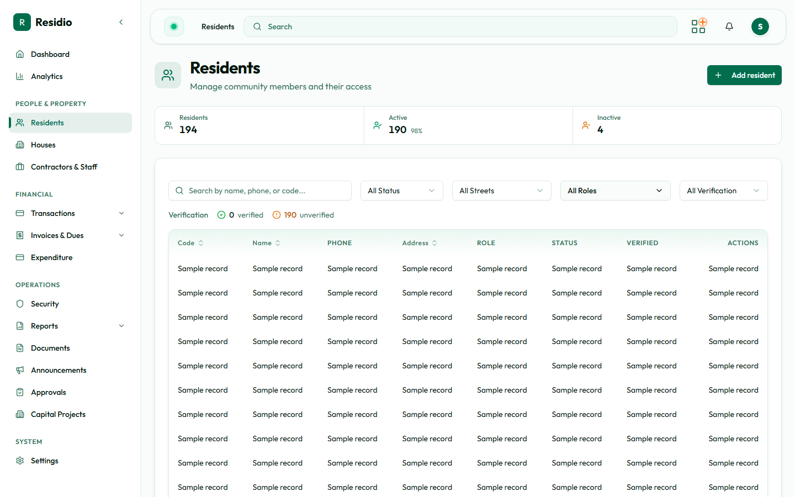

# Resident directory

Open **Residents** from the sidebar to see the estate roster. Use the search and filters before creating a new record so you do not create a duplicate.

## Find a resident

1. Search by first or last name, phone number, or the full resident code (a code must match exactly).
2. Filter by account status (active, inactive, suspended, archived), street, resident role (several can be ticked), and contact verification.
3. Open a row to inspect the resident profile, house assignments, invoices, wallet, and activity. The eye button previews the resident without leaving the list.

On a phone, each resident is shown as a card rather than a table row, with the same preview and edit buttons. **Add resident** and the edit button appear only for roles that can create or update residents.

## Directory hygiene

- Keep one canonical resident record per person.
- Use the resident code when communicating with finance or support.
- Mark a resident inactive only after confirming the move-out or account-closure workflow.
- Preserve relevant notes and assignment history rather than overwriting historical context.

## Next steps

- [Add and assign a resident](./add-and-assign-resident)
- [Review resident details](./resident-details)
