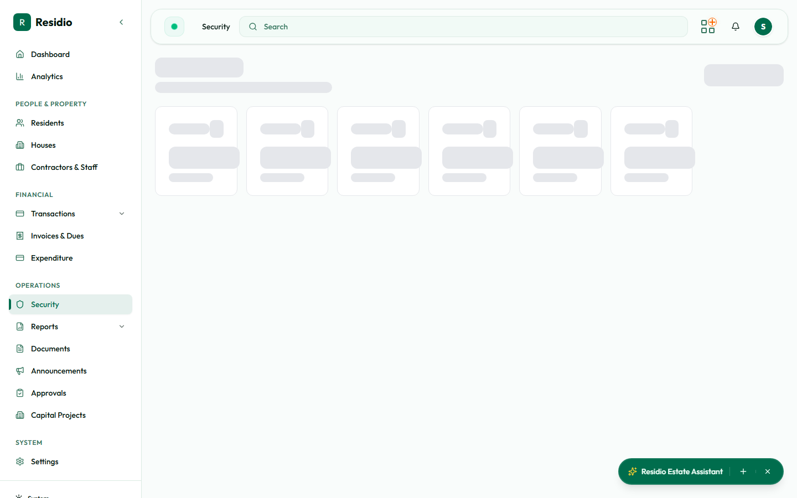

# Security contacts

Open **Security** to review active contacts, access information, and security activity.

## Add a contact

1. Select **Add Security Contact**.
2. Enter the contact identity and phone details.
3. Link the contact to the correct resident or property where required.
4. Set the validity period and access category.
5. Review the details and save.

## Maintain the list

Filter by active status, category, resident, or expiration. End or update a contact when the underlying authorization changes. Avoid deleting historical records when the workflow provides an end or deactivate action.

## Generate an access code

Open an active contact and select **Generate Code**, or use the **Code** menu on a resident's security contacts card. **Multi-use Code** creates a code that can be used repeatedly until its displayed validity window ends. The menu shows that window before generation; it uses the contact category's default or 30 days when no category default is set. **One-Time Code** remains available for a single use and follows the same configured expiry window.

To replace a code that may have leaked, select the regenerate icon beside it on the contact's page and confirm. The old code stops working at once, and a new code with the same type and expiry replaces it. Share the new code with the contact. Regenerating needs the same permission as generating a code.

## Vehicles

The **Vehicles** card on a contact's page, and below the form while you edit the contact, lists the plates registered to that contact. Each control appears only to roles holding the matching permission:

- **Add Vehicle** registers a plate (register contacts). Plates are stored in upper case without spaces or dashes and must be unique among active vehicles across the estate.
- The star icon makes a vehicle the contact's primary vehicle, and the edit icon changes its details (update contacts). A contact has at most one primary vehicle.
- The remove icon deactivates a vehicle (suspend or revoke contacts). Past access logs keep the plate.

## Visit history and analytics

Roles that can view access logs see a **Visit History** card on each contact's page: visits in the last 90 days, average stay, usual gate, flagged visits, and a paged list of check-ins.

The **Analytics** tab on **Security** shows visits today, this week and in the last 30 days, average stay, recurring visitors, registered vehicles, frequent visitors, and every contact ranked by visit count. It is read-only. Roles that can also view contacts see the recurring visitors expected today.

:::warning[Access data]
Treat contact details and access codes as sensitive operational data. Do not copy them into chat, screenshots, or external spreadsheets.
:::
