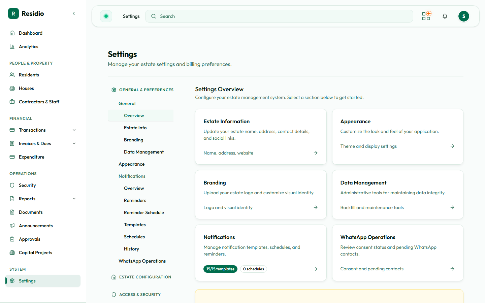

# Settings overview

Settings are grouped by the decision they control.

- **Estate:** estate identity, branding, appearance, streets, house types, document categories, and document tags and custom fields.
- **Financial:** billing rules, late fees, invoice generation, levies, billing profiles, bank accounts, and transaction tags.
- **Communications:** the notifications dashboard, reminders and their schedule, notification templates and schedules, email notifications, message templates, and announcement categories.
- **Access & Security:** role and permission definitions, security settings, and security contact categories.
- **Integrations:** external services — WhatsApp and Gmail import today, with Paystack and SMS planned. Each keeps its credentials and its day-to-day console (consent, sync status, manual actions) together, rather than splitting configuration from operations the way the other groups do.
- **Maintenance & Data:** maintenance mode and data retention.

**Resident portal switch.** **Settings → Estate Information** has a *Resident portal* card with one switch. It decides whether the resident portal links (*My Portal*, *Resident Portal* in the profile menu, and *View as Resident*) appear in the admin dashboard. It is off by default and needs the general settings permission to change. The switch only hides or shows links: it does not block the `/portal` address, so anyone who opens `/portal` directly still reaches it. An individual account can override the switch under **System → Accounts**.

The rest of **Settings → Estate Information**, including the AI assistant switches, saves together from the save bar that appears when something has changed; email and web addresses must be valid before it saves, and the page warns before you leave with unsaved changes. Removing the logo under **Branding** asks first.

Day-to-day account work — assigning roles, watching cron jobs, the notification queue and history, audit logs — lives under **System** in the main sidebar, not Settings: Settings holds configuration, System holds live state and account operations.

:::info[You see only what you can open]
Both this page and the Settings sidebar show only the sections your role can actually reach, so two admins will see different menus. If a colleague cannot find a page described in this guide, their role does not hold the permission for it — see [Roles and permissions](../getting-started/roles-and-permissions.md). The Chairman role can open Settings and navigate to the areas their permissions allow — announcements, documents, billing profiles, email imports, notifications, security categories, and WhatsApp — but does not see configuration pages or system maintenance.
:::

Change one setting at a time, save, and verify the affected workflow. Configuration changes can alter what other admins see or what automated jobs do.
